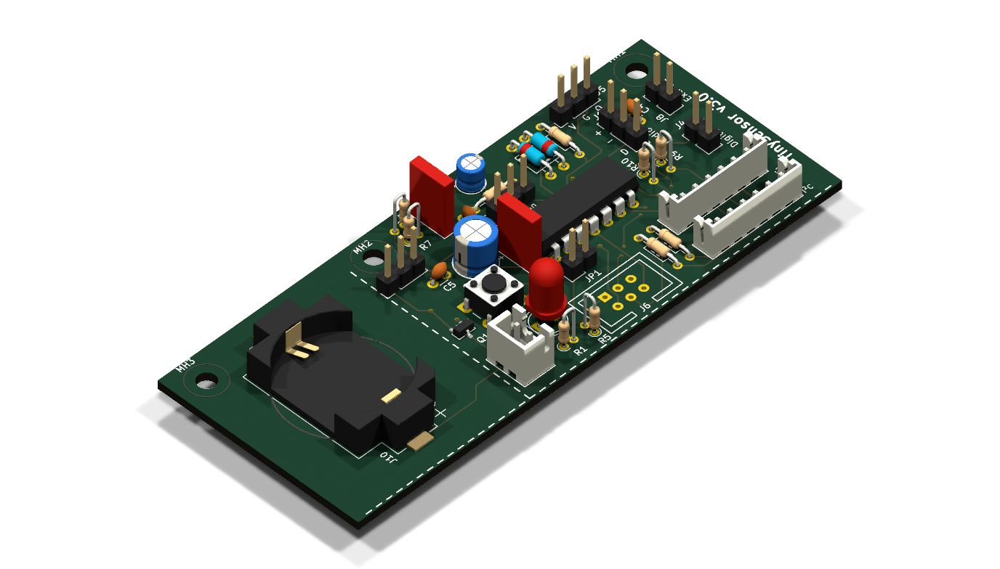
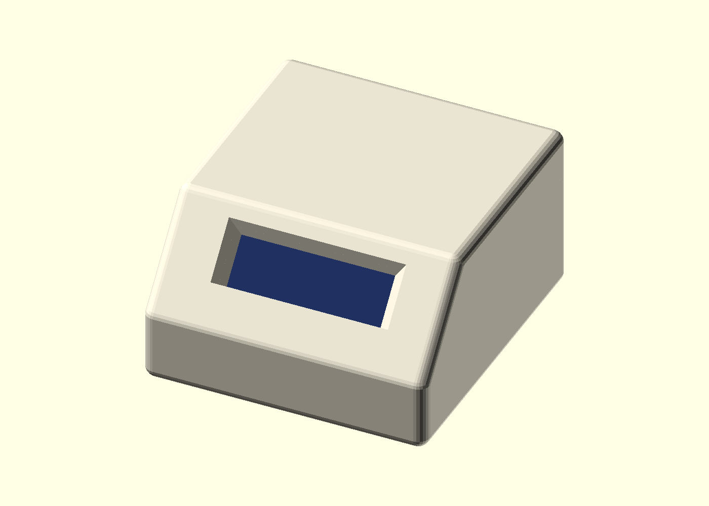

# TinySensor 

[](https://github.com/arcadien/tinySensor/actions/workflows/main.yml)

TinySensor aims to provide a customisable firmware and a hardware design for low-power environment sensors using wireless communication.

In the complete system, data is processed by a [Domoticz](https://domoticz.com/)/[RFlink](http://www.rflink.nl/blog2/) couple.
Data decoding is also tested using [RTL_433](https://github.com/merbanan/rtl_433) decoder.
Large part of the code, especially wireless encoders, are unit-tested.

| TinySensor v3.0 board | tinyDecoders receiver |
|:---:|:---:|
|  |  |

## Supported MCUs
* ATTiny84a

## Supported sensors
* I2C sensors (eg. [Bosch BME/BMP280](https://www.bosch-sensortec.com/bst/products/all_products/bme280))
* Analog sensors (eg. [LM35](http://www.ti.com/lit/ds/symlink/lm35.pdf))
* OneWire sensors (eg. [Dallas DS18S20](https://datasheets.maximintegrated.com/en/ds/DS18S20.pdf))
* Luminosity sensor ([ROHM BH1750](https://www.mouser.com/datasheet/2/348/bh1750fvi-e-186247.pdf), I2C)

## Wireless technology
* "one pin" emitters. Tested with low-cost 433 MHz emitters.

## Wireless protocols
* Environment frame (temperature, humidity, pressure): Oregon Scientific v3 **or** Lacrosse WS7000, at most one per build. A build without either sends no environment frame.
* Luminosity: always a dedicated Lacrosse WS7000 frame (Oregon has no light frame), so `LACROSSE_ID` is required whenever the BH1750 is fitted.
* Battery level and analog input: optional X10 RFXmeter frames, not sent when the battery is low.

## Used libraries
Various libraries are used here, and some where tweaked to remove any Arduino dependencies, making the whole firmware more compact:
* Sparkfun [BME280 sensor library](https://github.com/sparkfun/SparkFun_BME280_Arduino_Library) with all SPI related code removed
* [Tiny I2C](https://github.com/arcadien/tiny-i2c.git) of [David Johnson-Davies](https://github.com/technoblogy)
* [Unity test harness](http://www.throwtheswitch.org/unity) from Throw The Switch, for all testing code
* DS18B20 library of [Jacek Wieczorek](https://github.com/Jacajack/avr-ds18b20)

## Useful documentation about low power AVR
* [AVR4013: picoPower Basics](http://www.microchip.com/downloads/en/AppNotes/doc8349.pdf)

## Development

The firmware is built with [PlatformIO](https://platformio.org/) and configured entirely at build time: each physical sensor is one PlatformIO environment (`S_02`…`S_05`, `robot`, `devmodule`, `SOLAR_TEST`) whose `build_flags` select protocol, sensors and calibration. See [docs/environments.md](docs/environments.md) to calibrate or add a board.

```bash
pio test -d emitter -e native_debug        # encoder and library unit tests, on the host
pio test -d emitter -e native_cycle_oregon # one measurement cycle (runCycle) per build variant;
                                           # also native_cycle_oregon_vcc, _lacrosse, _x10
pio run -d emitter -e S_02                 # firmware for one board
pio run -d emitter -e S_02 -t upload       # flash it
```

> **Flashing with a BME280 plugged in.** ISP and I2C share the ATtiny84A pins PA4 (SCK / SCL) and PA6 (MOSI / SDA). On **v3.0**, R9 and R10 (330 Ω) sit in series between the MCU and the sensor connectors J3/J14, so the programmer drives SCK and MOSI without the sensor holding them: the board should flash with the BME280 in place (not yet checked on a built board). On **v2.2 and earlier**, unplug the BME280 before flashing, otherwise flashing fails; always wire it through its JST connector, never solder it to the board.

CI runs the native tests, compile-fail checks for invalid flag combinations (`emitter/test/compile_fail/`), sensor-variant checks (`emitter/test/build_variants/`), `clang-format` and a build of every board.

* Architecture: [docs/architecture.md](docs/architecture.md)
* Step debugging over debugWIRE: [docs/debugging.md](docs/debugging.md)
* Requirements: see [Requirement-based development](#requirement-based-development) below

## Requirement-based development

This project follows requirement-based development (RBD): every behaviour of the firmware, the receiver and the boards is written down as a requirement before it is tested and coded. Each requirement, its tests and the commits that implement it can therefore be traced to each other.

The cycle for each change:

1. **Requirement.** The change is first written as a requirement with an ID such as `FUNC-OREGON-001` (category, domain, number), a status (`validated` or `draft`) and its dependencies.
2. **Tests.** Tests are written next. Each Unity test function carries the ID it verifies on the line above it: `// @req FUNC-OREGON-001`. Requirements that no host test can observe (AVR registers, wiring, bench measurements) say instead how they are verified: by inspection, by a build, or on the bench.
3. **Code.** The code then makes the tests pass. The linter (`clang-format` 18.1.8) and the full native test suite must pass before each commit.
4. **Commit.** Each commit names what it serves: `req(ID):`, `test(ID):`, `feat(ID):`, `tech(ID):`, `conf(ID):` or `arch(ID):`; `plan:` for workflow files; `hw:`, `docs:`, `fix:` or `chore:` outside the code cycle. A pre-push hook rejects a code commit whose ID is missing or not `validated`.

`git log --grep FUNC-MAIN-001` and `grep -rn FUNC-MAIN-001 emitter/test` show where a requirement was written, tested and implemented.

| Document | Contents |
|---|---|
| [requirements/functional.md](requirements/functional.md) | `FUNC`: observable behaviour: radio frames, measurements, battery, receiver decoding, RFLink lines |
| [requirements/ui.md](requirements/ui.md) | `UI`: what the receiver OLED shows |
| [requirements/configuration.md](requirements/configuration.md) | `CONF`: build flags, PlatformIO environments, CI |
| [requirements/platform.md](requirements/platform.md) | `PLAT`: hardware use: pins, registers, timers, sleep, board pull-ups |
| [requirements/technical.md](requirements/technical.md) | `TECH`: classes, interfaces, memory layout, test doubles |
| [requirements/performance.md](requirements/performance.md) | `PERF`: none yet |
| [docs/architecture.md](docs/architecture.md) | Component diagram, dependency injection map, and a requirement → component traceability table |
| [audits/](audits/) | Audit and review reports. Each one starts with the commit it audited, so `git diff <hash>..HEAD` shows what changed since |
| [audits/exclusions.yml](audits/exclusions.yml) | Audit findings accepted on purpose, with their justification |
| [.rbd/config.yml](.rbd/config.yml) | ID format, test tag convention and linter command |

Non-technical requirements (`FUNC`, `UI`, `CONF`, `PLAT`) describe what can be observed, without class or function names. Those details live in `TECH`. Requirement IDs cited in these documents link to their heading. The workflow is driven by the [`rbd` Claude Code plugin](https://github.com/arcadien/claude-marketplace/tree/main/plugins/rbd) (`/rbd`, `/rbd-audit`, `/rbd-review`); see `CLAUDE.md`.

## Hardware and enclosure

* KiCad board (v3.0) in `hardware/tinysensor/`, with its [backlog](hardware/tinysensor/BACKLOG.md) and a [rework guide for v2.2 boards](hardware/tinysensor/REWORK_v2.2.md).
* OpenSCAD enclosures (wall box, radiation shield, mushroom, receiver) in `enclosing/`, see [enclosing/README.md](enclosing/README.md).
* Header renders: `kicad-cli pcb render --rotate '-45,0,45' --quality high --width 1400 --height 800 --zoom 1.22 -o docs/img/tinysensor_v3_iso.png hardware/tinysensor/tinysensor.kicad_pcb` and, from `enclosing/receiver/`, `openscad --preview -D 'part="assembly"' --camera=0,0,0,55,0,25,0 --viewall --autocenter --projection=o --imgsize=1400,1000 -o ../../docs/img/receiver_iso.png receiver.scad`.

## Hardware options

TinySensor can use combination of sensors, the limit comes from amount of flash memory on the ATTiny.

### DS18B20

OneWire sensor, cheap and efficient.

### BMP/BME 280 environment sensor
The [BMP280](https://www.bosch-sensortec.com/products/environmental-sensors/pressure-sensors/pressure-sensors-bmp280-1.html) and the [BME280](https://www.bosch-sensortec.com/products/environmental-sensors/humidity-sensors-bme280/) share the same library, but the BME provide humidity sensing, and thus use more memory.

### Analog sensor

Analog sensor can be used for [LM35](https://www.ti.com/lit/ds/symlink/lm35.pdf) temperature sensor, or [LDR](https://en.wikipedia.org/wiki/Photoresistor).

### LM35 temperature sensor

On v2.2 and v3.0 boards running from 2×AA/AAA, the LM35 can be powered by an off-board 5 V boost module switched on PB2 only during measurements (`USE_SWITCHED_5V`), see [VARIANTE_LM35.md](hardware/tinysensor/VARIANTE_LM35.md). The instructions below are for v2.1.

#### Without negative temperature support
A 0v ground reference is needed.
Solder pads *2* and *3* of **J4**, (rear side) as well **JP3**. 

#### With negative temperature support
In the case of a *-CAZ* version, temperature below 0 can be measured. 
To allow this, two 1N914 diodes must be placed to put the sensor reference below 0v. This setup is documented in the LM35 datasheet.
On TinySensor board v2.1 and up, this can be implemented by:
* solding **D2** and **D3** diodes
* solding **R4** with a value of 18k
* solding **JP3** to bypass C3 capacitor
* solding pads *1* and *2* of **J4** (rear side) to set ground reference.

#### Notes about swing

You can add a filter capacitor *C3* to avoid swing if the wire is long. In this case, do not solder *JP3*.
See datasheet for details.

### LDR
Use the right value for **R4** (should match the used LDR) and solder **JP3** and, on **JP4**, middle and *3* pads. This way, there will be no RC filter (no cap because of **J3**) and Vss analog reference thanks of **JP4**.
