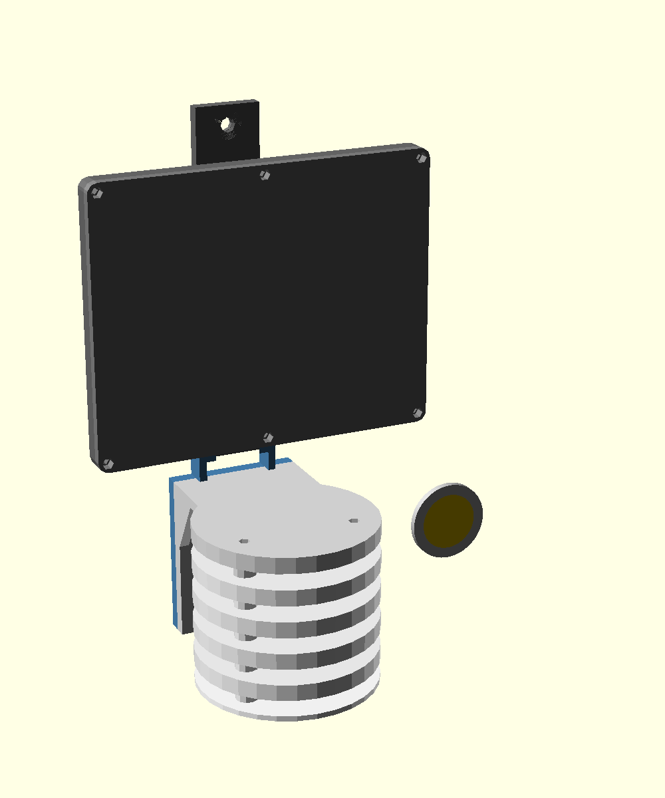
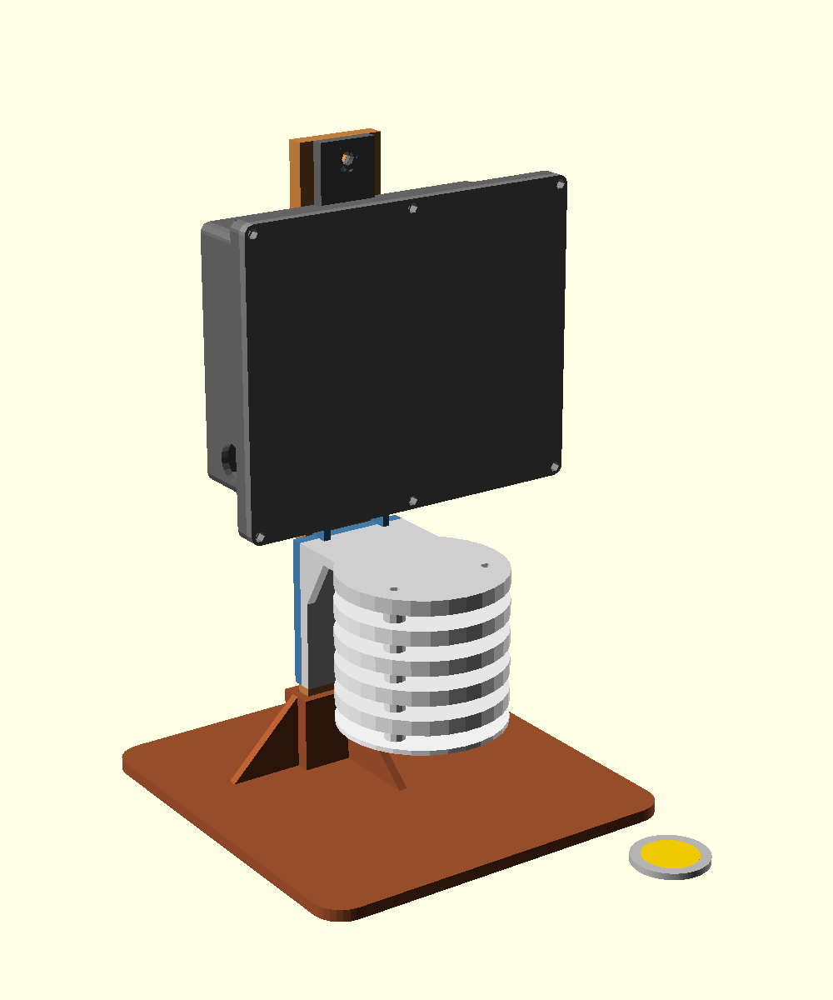

# Wall box, radiation shield, table stand

| On the wall | On a stand |
|---|---|
|  |  |

| File | Content |
|---|---|
| `tinysensor_box.scad` | Main wall box (base + lid) |
| `sensor_shield.scad` | Outdoor radiation shield for a BMx280 breakout + optional clip |
| `stand.scad` | Table stand: mast + foot, to stand the box + shield upright |
| `assembly.scad` | Overview (box + clipped shield, on the wall or on the stand), generates `rendu.png` and `rendu_pied.png` |

> Status: **not printed, not validated** (wall box, shield, stand). Clearances and fits to confirm on the first print.

Orca projects: `box.3mf`, `shield.3mf`, `stand.3mf` (see [export](../README.md#export)).

Open-box render: `openscad --preview -D 'part="open"' --camera=110,-230,420,110,30,0 --imgsize=1400,1000 -o rendu_ouvert.png tinysensor_box.scad`.

## Main box (`tinysensor_box.scad`)

- Fitted to the v2.2 PCB (`hardware/tinysensor/tinysensor.kicad_pcb`): 93.98 × 63.75 mm, held by the 4 corner M2.5 holes on 5 mm standoffs.
- Clearance above the PCB: 25 mm (large capacitors), parameter `comp_h`.
- Free 14 mm bay on the bottom side (18650 holder side) for cables and antenna.
- Overall size: ~117 × 101 × 39 mm (flange and lid included).
- **Closure**: 6 M3 self-tapping screws, outside the seal area.
- **Sealing**: 2.2 × 1.5 mm groove for a Ø2 cord (printed TPU or EPDM), squeezed by a lid rib.
- **Wall mounting**: 2 tabs, Ø4 countersunk screws. The back stays solid.
- Variants (`usage`):
  - `ext`: Ø12.5 hole for a **PG7** cable gland (remote probe). By default in the **left side wall**, level with the bay, under the flange chamfer that keeps the rain off; `gland_side` = `left` / `right` / `bottom` (former position, bottom wall). The cable runs down along the box then up into the shield through its base: allow ~15 cm more and a drip loop.
  - `int`: top and bottom vent slots (convection).
- The bottom tab has two side notches for the shield clip (`shield_notch`).

## Radiation shield (`sensor_shield.scad`)

Stacked-plate shield (Stevenson type): outdoors, a BMx280 shut inside the sealed box would measure the box air, not the ambient air.

- Solid cap + 4 louvred plates + base, Ø56 mm, 10 mm pitch, ~52 mm high.
- Assembly: 3 **M3** threaded rods through the spacers, nuts under the base.
- Base: vertical slide for the **15 × 11 mm, 6-pin** breakout (`BMx280_breakout` footprint), Ø6 cable pass underneath, 6 drain holes.
- Print in **white** (limits solar heating). Place in the shade if possible.

### Mounting (pick one)

1. **Wall**: plate with 2 Ø4 countersunk screws on the probe side. Screw the cap to the wall **before** stacking the plates.
2. **Clip under the box** (`part="clip"`): adapter bolted behind the plate (2 M4×8 countersunk screws + nuts sunk on the wall side). Its two prongs grip the bottom wall tab of the box (45° lips) and a bump snaps into each notch. Fitting: screw the box, slide the shield up until it clicks.
   - Adjustable fit: `bump_r` (grip), `prong_w` (stiffness).

3. **On the stand** (`stand.scad`): see below.

## Table stand (`stand.scad`)

To stand the box + shield upright on a table, with no wall.

- **Mast** 30 × 6 × 212 mm: it stands in for the wall. The box screws onto it by its two wall tabs (M4 countersunk, nuts sunk in the back of the mast); the shield stays clipped under the bottom tab, as on the wall.
- **Foot** 130 × 136 mm with a 25 mm socket and gussets: the mast fits in and is locked by a through M4 screw. It reaches 90 mm forward to balance the shield, which sticks out to ~72 mm from the mast.
- 30 mm of clearance under the shield (`under_clr`) for the loop of the cable that comes up through the base.
- The mast (212 mm) fits a 220 × 220 bed.
- The box and shield dimensions are copied at the top of the file: realign them if the other models change.

### Wiring

- I2C link < 1 m: 4.7 kΩ pull-ups, twisted cable (SDA/GND, SCL/GND).
- The cable leaves the cable gland and runs up into the shield through its base.

Board connectors and module wiring: [`hardware/tinysensor/WIRING.md`](../../hardware/tinysensor/WIRING.md).

## Screws and fixings

| Use | Qty | Reference |
|---|---|---|
| PCB → standoffs | 4 | M2.5 × 6 self-tapping |
| Lid | 6 | M3 × 8 self-tapping |
| Box → wall | 2 | Ø4 countersunk + wall plugs |
| Cable gland | 1 | PG7 |
| Seal | ~45 cm | Ø2 TPU/EPDM cord |
| Shield: assembly | 3 | M3 threaded rod ~60 mm + 6 nuts |
| Shield → wall (option 1) | 2 | Ø4 countersunk |
| Clip → shield (option 2) | 2 | M4 × 8 countersunk + nuts |
| Box → mast (stand) | 2 | M4 × 10 countersunk + nuts |
| Mast → foot (stand) | 1 | M4 × 20 + nut |
