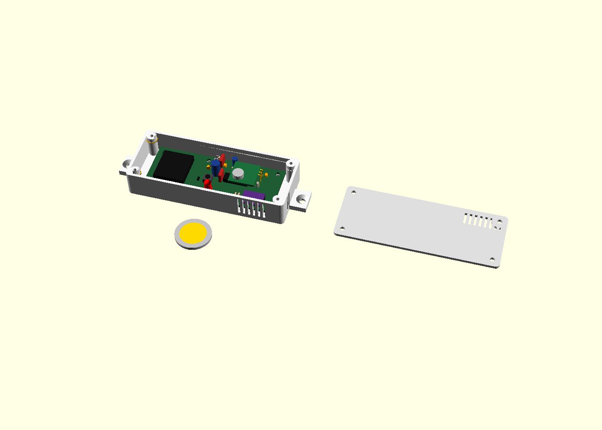
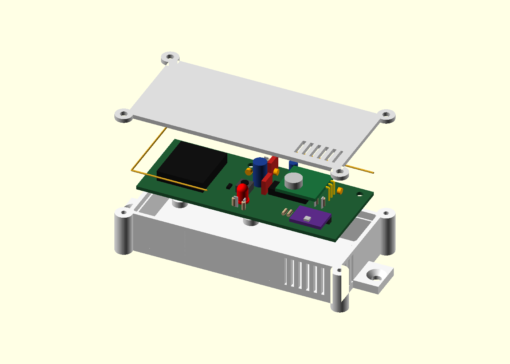

# Flat indoor box — CR2032 build

| File | Content |
|---|---|
| `flat_box.scad` | Flat base + lid for the full v3.0 board on its CR2032, sensor soldered to the board |

> Status: **not printed, not validated**. First draft: clearances, the radio module size and its pin length are estimates to confirm on the bench.

Indoor thermometer: no seal, no louvres. An outdoor (`ext`) variant was dropped: a seal groove needs a thicker wall, and rain-proof louvres don't fit a flat wall. For outdoors, use the wall box and its radiation shield (`../basic/`).

Export and render commands are in the `flat_box.scad` header (`part` = `base`, `lid`, `assembly`, `open`, `exploded`; `sensor` = `bme280` / `ds18b20`). The lid exports outer face down. Both parts print without support. The only overhangs are the 0.8 mm antenna groove roof and the tops of the 1.6 mm vent slots, both short horizontal bridges.

## Dimensions

| | `bme280` | `ds18b20` |
|---|---|---|
| Base (with the wall tabs) | 124.8 × 55.3 × 19.5 mm | 124.8 × 58.8 × 19.5 mm |
| Base without the tabs | 110.8 × 55.3 mm | 110.8 × 58.8 mm |
| Lid | 110.8 × 55.3 × 2 mm | 110.8 × 58.8 × 2 mm |
| Closed box height | 21.5 mm | 21.5 mm |

The parts fit an Ender 3 bed (220 × 220). The height is set by C1 (220 µF, Ø6.3 × 11.5 mm). C1 can't be laid over, because C2, C5, C7 and SW1 surround it and are all at least 4.3 mm tall. The flat radio comes to 10.9 mm, just under C1.

## Build

- Full (uncut) v3.0 board on 3 standoffs 3 mm high (MH1–MH3; cut the THT legs to 1.5–2 mm). Walls 2 mm, floor 2.4 mm, lid 2 mm.
- **Power**: CR2032 in J10. Remove the lid to change the cell; the board stays screwed in.
- **JP2 DIRECT Vcc closed**, nothing on J2 (no TPS63020).
- **C1 = 220 µF low-leakage** (e.g. Nichicon UKL): the CR2032 can't supply the radio pulses alone.
- Not fitted: J13, J4, J7, J8, the J6 ISP header (holes only), and JP1. JP1 left open turns the LED off, which saves the battery.
- **Radio**: the 433 MHz module is soldered straight into J1 with no header, its pins bent 90°. It lies flat over U1, components up, 5.8 mm above the board (it clears R9/R10). Match the pins by name: J1 is GND / VCC / DATA, while an FS1000A is DATA / VCC / GND. If the module pins are too short, extend them with 3 short wires.
- **Antenna**: a 17.3 cm wire on the module ANT pad. It runs in the 1.2 × 0.8 mm groove along the inner wall, 3 mm under the rim, and the groove stops before the vents.
- **Wall mounting**: 2 end tabs, Ø4 countersunk screws. Or just stand the box on a shelf.
- **Vents**: plain 1.6 mm slots in the wall and the lid next to the sensor. There is no internal chamber: self-heating is negligible because the board sleeps 99 % of the time.

### Sensor (`sensor`)

| Variant | Soldered to | Position | Settings |
|---|---|---|---|
| `bme280` | 6-pin breakout (VIN GND SCL SDA CSB SDO), its male header soldered straight into the **J3** holes, VIN on pin 1. J3/J14 JSTs not fitted | lying flat on the header (2.5 mm), towards the board edge, over the empty J14 footprint; vents in the bottom and right walls and in the lid | **JP6 bridged 1-2** (SDO = GND, address 0x76). Check that CSB is pulled up on the breakout (see `hardware/tinysensor/WIRING.md`). Header at 2.54 mm in the 2.5 mm JST holes: 0.1 mm off per end, it goes in |
| `ds18b20` | TO-92 straight into **J5**: VDD → pin 1 (VCC), GND → pin 2, DQ → pin 3 (cross the legs, the TO-92 order is GND DQ VDD) | legs bent 90°, flat face down, the body 2.8 mm past the top board edge (MH side); vents in the top wall and in the lid | pull-up R6 is on the board |

## Parts

| Qty | Part | Use |
|---|---|---|
| 3 | M3 × 6 self-tapping (or plastite) | board on the standoffs |
| 4 | M3 × 6 self-tapping | lid, into the corner lugs |
| 2 | Ø4 countersunk wood screw + plug | wall tabs (optional) |
| 1 | CR2032 | power |
| 1 | 220 µF low-leakage electrolytic, Ø6.3, 2.5 mm pitch | C1 |
| 1 | 433 MHz OOK transmitter (FS1000A) + 17.3 cm wire | radio |
| 1 | BME280 6-pin breakout **or** DS18B20 TO-92 | sensor |
