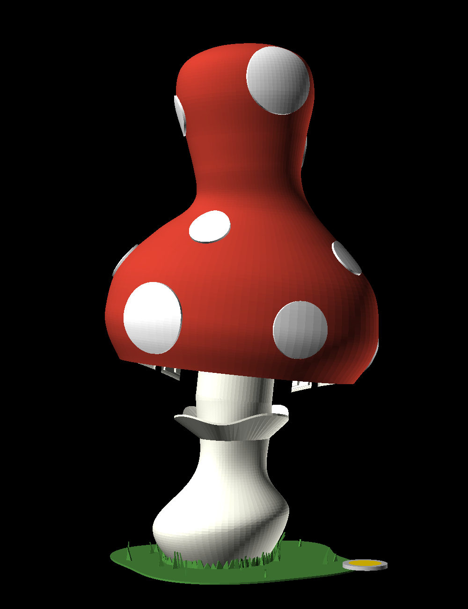
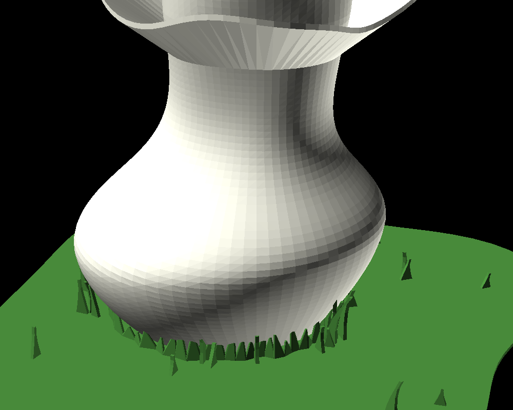
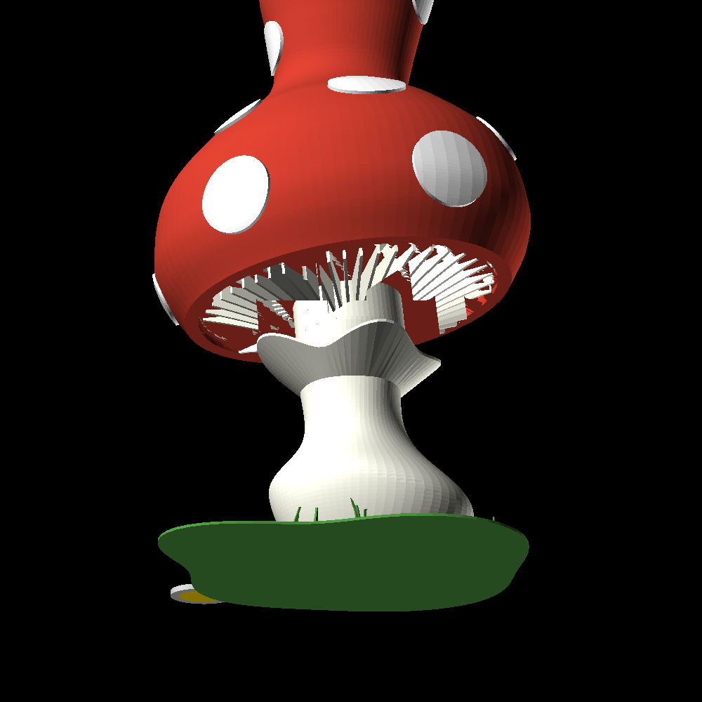
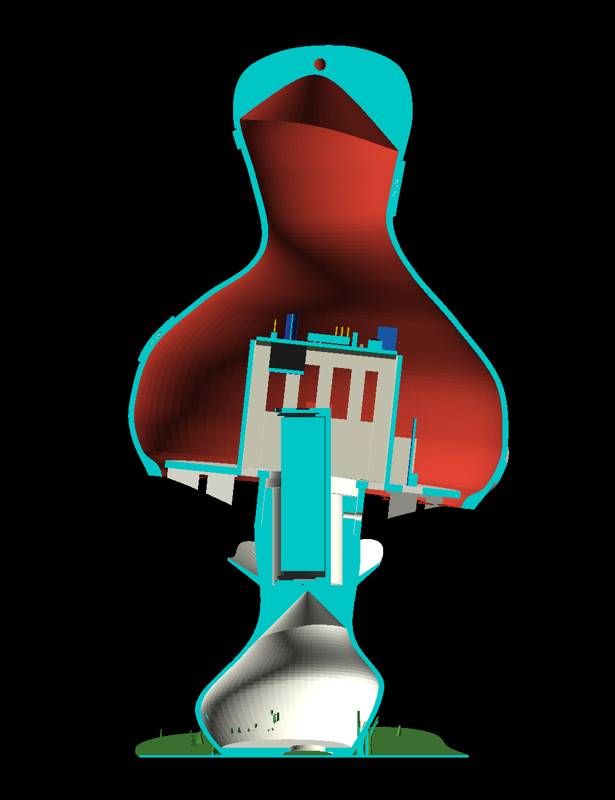
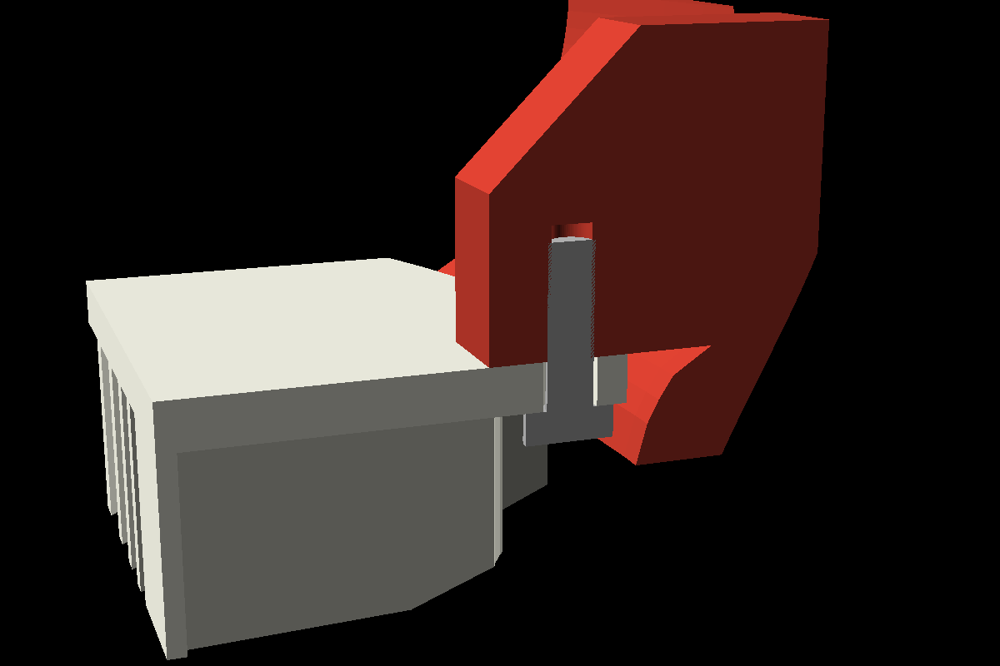
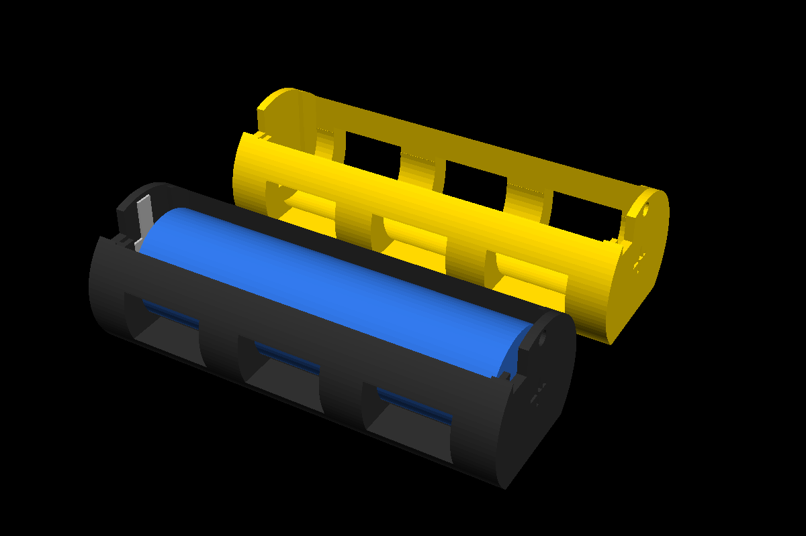
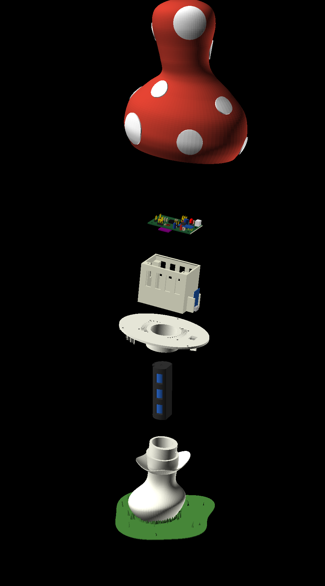
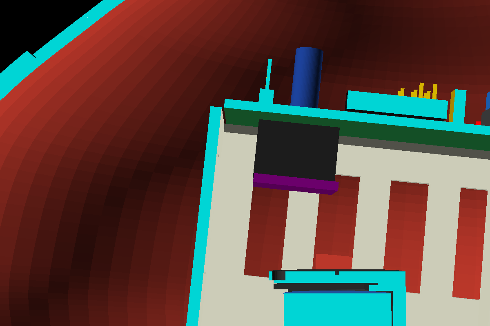

# Mushroom enclosure (`mushroom.scad`)

Decorative fly-agaric variant, which does not replace the wall box. The cap is one piece (dome + gills) sitting on the stem with a slight tilt; all the electronics are in the cap, the stem only carries the cell.

| Overview | Side | Stem | Underside | Section |
|---|---|---|---|---|
|  |  |  |  |  |

Parts:

- **Dome** (`cap`) ~161 × 129 × 190 mm (ellipse of mean max radius 72): **gourd** after a sketch, meridian `cap_shape` (wide bottom, waist Ø~55, top Ø~72), **elliptic outline** (see below). From the narrowing zone (`cap_neck`) up, the top leans 8° towards −X (`cap_lean`, against the cap tilt), to bring the mass back over the stem axis: top ~6 mm from the stem axis on the +X side. The board is turned 180° in the chassis so that the top stays right above **J1 "RADIO"** (433 MHz module), along the board axis (`cap_top` is computed), 126 mm above the board. **Vent** Ø5 (`vent_d`): from the ceiling tip, it runs ~15° down towards the rear flank (+Y), with no dots around it; rain stays out and warm air leaves, opposite J1. The bulk of the bottom goes the other way, towards the flare of the stem. Inner ceiling conical at 45°, no support: the top is solid under the tip. The wall keeps curving inwards down to its edge (no vertical skirt, no outer lip, ~27° from the vertical at the bed); the edge drops 4 mm below the gill disc (hides its edge) and thickens inwards to **6 mm wide** (`rim_w`, 45° blend): ~2.4 times more bed contact for a 190 mm high part, same silhouette. Fixing: 3 **corbels** on the inner wall, just above the disc (`corbel_*`: 12 mm wide, 10 mm straight face then 45° chamfer to the wall, Ø2.5 × 8 pilot hole); the disc rises into the dome and is pulled against them by 3 M3 × 10 self-tapping screws from below, heads under the disc between the gills. 
- **Gills** (`gills`): disc closing the underside of the cap, following the narrowest outline of the dome skirt minus 0.4 mm (`disc_fit`) to clear the skirt, 48 radial blades deeper near the stem (`gill_depth`), cut short around the 7 screws driven from below (dome and chassis, `screw_clear` 4.5 mm for the head and the screwdriver) instead of being left out, vent slots between the blades under the sensor chamber (including on the +X side, at 0° and ±7.5°, flush with the +X edge of the BME280), USB socket opening, central sleeve taking the stem tenon. Prints blades up.
- **Chassis** (`chassis`) 65.65 × 44.13 × 54.6 mm outside, 8 mm corner bosses, screwed onto the disc (4 M3 screws from below), printed upright:
  - lower chamber (48 mm, `chamber_h`), ventilated: **BME280 plugged under the board**, no wire or slide (see *Wiring*); the breakout hangs parallel to the board, sensor towards the disc, 42 mm above the disc; chassis windows at the top of the chamber (`win_h`), so that air flows past the sensor. The top of the cradle goes 30 mm through the disc (Ø37 hole, `disc_bore`) and ends 12 mm below the breakout, with the JST-XH pair;
  - **cut v3.0 board** (60.85 × 39.33 mm, cut along the silkscreen dotted line x = 147, without the CR2032 area; the v3.0 board has no 18650 holder): turned 180° (J1 on −X), 2 M3 screws (MH2, MH1), the bottom edge rests on a ledge. The cell arrives on **J13 "RAW IN"** (JST-XH 2-pin, pin 1 `RAW_IN`, pin 2 `GND`). The dome top stays where it was designed over J1 of the cut v2.2 board (`cap_j1`, 0.45 mm from the v3.0 J1), so the dome and the dots are unchanged;
  - slide for the TP4056 **charge module**, upright on the side, **micro-USB facing down** between two gills.
- **Stem** (`stem`) as a **fly-agaric pear** after a sketch: slender, lopsided bulbous base (~80 × 75 mm at the belly; on the table 19 mm from the axis on the short side, 37 mm on the long side), neck Ø36 to 44 below the ring, Ø45 under the sleeve, hollow (Ø29.4) to the top: takes the cell cradle, inserted from the top, sitting 72 mm above the ground. Underneath, a closed **ballast chamber** following the stem shape (2.4 mm wall, `ballast_wall`, bulb included), conical ceiling at 45° up to 70 mm (`ballast_h`): ~146 cm³, i.e. ~690 g of 1 mm steel shot if filled. Filled through a Ø15 hole in the bottom, closed by a **plug** (`plug`, Ø21 × 1.2 mm) glued into a counterbore, flush with the underside. Same spirit as the cap:
  - lobed shaft (`stem_amp`, lobes twisting along the shaft, `stem_twist`); the deformation only adds material, the wall around the cell never gets thinner, and it fades out under the sleeve;
  - asymmetric bulbous base (`bulb_r`, `bulb_z`, `bulb_up`, `bulb_dn`, `foot_dir`): belly low and wide on the long side, high and tight on the short side (`bulb_z` per side), underside rounded at 44° at most;
  - **cup** ring under the cap (`ring_z`, `ring_ext`, `ring_rise`), raised wavy edge (`ring_amp`), 45° at most: no support. The waves are phased (`ring_rot`) so that the cup dips under the USB socket: its edge stays 2 mm short of the window under the plug (checked by an `assert`), the cable plugs in from below.
  - At the top, a tenon tilted 6° (`cap_tilt`) fits into the sleeve, 1 radial M3 screw on the +X side, under the USB socket (`collar_screw_a`).
- **Cradle** (`cradle`) 74.8 × Ø27.8 mm: removable trough for a **bare 18650** (65 mm, flat top; `cell_l` for another length), no solder on the cell. Two **tab contacts** (13 × 11 mm plate, drilled 3 × 7 tab) slid into grooves: spring on the "−" side at the bottom, bump on the "+" side at the top (polarity engraved on the ends). Tabs up: each wire soldered on them leaves through the nearby notch (`wire_notch`) and runs along the cell in the top slot up to the sleeve (W1 red 40 mm, W2 black 110 mm, soldered → JST-XH F, see *Wiring*); the wires are soldered to the tabs, not to the cell. The cell goes in through the top slot, compressing the spring (≈ 4 mm, `spring_c`). Ø2.5 pull hole at the top (string, knot inside). Flanks lightened by 3 windows on each side, under the lips that hold the cell (`cr_win`, 15.5 g instead of 21 g solid). Printed flat, flat face on the bed, no support. 
- **Ground** (`ground`): 1 mm disc with a lobed outline (Ø~145, `ground_R`), zigzag grass fringe around the stem, tufts of tall blades and single blades (`grass_*`, `fringe_h`). Separate part to print in green; the stem is glued on it. Widens the footprint.
- **Dots** (`dots`) added afterwards: 13 (Ø24 × 7, Ø32 × 4, Ø40 × 2), spread by random draw over the real surface (minimum gap `dot_gap`), the OpenSCAD echo gives the count per size. Each dot is cut from the dome shell itself, 2 mm thick (0.8 mm sunk in its recess, `dot_pocket`, 1.2 mm proud, `dot_h`), so it fits its own spot only: its number is engraved under it and at the bottom of its recess. No dot across the concave waist, where a disc could not follow the surface. Printed standing on its edge (`dot_row` between rows, 5 mm brim): the shell leans less than 35° from vertical, so the visible face comes out smooth; Orca supports only carry the bottom of the disc.

Total height ~300 mm.

## Cap outline

The top-view outline is a convex ellipse, `ell_ratio` = minor / major axis (0.8 by default, 1 = round), same area as a circle of radius `cap_R`, the same at every height. The edge stays flat (printed edge on the bed).

- `ell_rot`: major axis orientation; `-1` (default): OpenSCAD picks the orientation that leaves the most clearance around the electronics (0°, along the board). The 3 dome screws stay at `tab_base`.
- The console shows the **clearance index**: ≤ 1 = chassis, board (components ≤ 14 mm) and charge module ≥ 3 mm from the dome everywhere; otherwise a warning (raise `cap_R` / `cap_H` or `ell_ratio`). The console also shows the wire margin above the cradle; `stem_h` and `ballast_h` do not go below 5 mm of margin (assert).

## Printing

- Every part comes out in its print orientation. The **dome** (190 mm high, fits an Ender 3) prints edge on the bed, **without support**: printed in PETG (~20 h), the corbel bearing faces, 7 mm above the bed, bridge over more than 20 mm with two right angles. Low infill (~10 %): the top is solid in the model (~60 cm³, 76 g at 100 %, ~8 g at 10 %), only to avoid supports behind the neck, and it weighs in the wrong place. The other parts print without support (stem: 113 mm high).
- Stem: **6 walls** (0.4 nozzle): the ballast chamber wall is 2.4 mm (`ballast_wall`), so it is solid without gap infill. 4 walls are enough for the other parts.
- Dome in red (or brown: panther cap), dots in white, ground in green, the rest in white / ivory.
- Ground: blades and fringe 0.9 mm thick, tips at 0.6 mm (0.4 nozzle); the slicer may truncate the finest tips.

## Assembly, cell

0. Stem upside down: shot through the bottom hole (a few drops of glue to freeze it and stop it rattling), plug glued into its counterbore (epoxy), then stem glued onto the ground.
1. Board: solder a **2.54 mm 1×6 female header** on the **underside** of the board, in the J3 footprint ("I2C 1"); the J3 and J14 JSTs are not fitted (see *Wiring*). Bridge **JP6 1-2** (solder jumper under the board, delivered open): SDO to GND, address 0x76. On the breakout, solder its male header so that the chip faces the disc once plugged in (breakout body towards the inside of the chassis, to check for your breakout model).
2. Charge module: solder W5 / W6 (red / black, 70 mm, OUT+ / OUT− soldered → JST-XH (F) 2p for J13). W3 / W4 are soldered in step 3: the JST-XH housing (~7.4 × 5.8 mm) barely fits through the window of the +Y wall (8 mm wide), so the bare end is passed through.
3. Board screwed on top of the chassis; chassis upside down, BME280 plugged in from the open underside of the chassis. Charge module in its slide; W5 / W6 (red / black, 70 mm, TP4056 soldered → JST-XH F) plugged into J13; W3 / W4 (red / black, 100 mm, TP4056 soldered → JST-XH M): JST-XH M already crimped, chamber side; push the other, bare end from inside the chamber outwards through the +Y wall window (x = 22), then solder it to B+ / B− of the TP4056; the JST side stays in the chamber, above the cradle. Finally chassis onto the gill disc (4 screws from below).
4. Gill disc pushed into the dome up to the 3 corbels, 3 M3 × 10 self-tapping screws from below (heads between the gills). The 433 MHz module antenna goes straight up from J1 into the top of the gourd.
5. Cradle: contacts in the grooves, W1 red 40 mm / W2 black 110 mm soldered at the top of the tabs, out through the end notches (W2 runs along the cell in the top slot) → JST-XH F; cell clipped in; cradle into the stem from the top (spring at the bottom).
6. Cap held ~50 mm above the stem, plug the JST-XH pair, tuck it into the chamber just above the cradle (central hole of the disc), cap fitted on the tenon, radial screw.
7. Changing the cell: remove the radial screw, lift the cap (~50 mm): the JST-XH pair shows, unplug it, pull the cradle out by the string.

## Wiring (mushroom)

Printable A4 plan: [`faisceau_champignon.pdf`](faisceau_champignon.pdf) (generated by `python3 harness.py`). Board connectors: [`hardware/tinysensor/WIRING.md`](../../hardware/tinysensor/WIRING.md).

**Sensor, no wire.** The BME280 breakout (6 pins VIN GND SCL SDA CSB SDO, ~15 × 11 mm) plugs its male header straight into a **2.54 mm 1×6 female header** soldered under the board, in the J3 ("I2C 1") footprint (6-pin JST-EH, 2.50 pitch: 0.2 mm cumulated offset over 6 positions, absorbed by the play of the Ø1.05 holes of v3.0).

- Positions 1-4 = SENSOR_VCC, GND, SCL, SDA = VIN, GND, SCL, SDA.
- Position 5 not connected = CSB: the breakout pull-up keeps the I2C mode.
- Position 6 = SDO, through JP6: bridge **JP6 1-2** (GND) for address **0x76**, the one the firmware expects. JP6 is delivered open on v3.0.
- I2C pull-ups R2 / R3 4.7 kΩ on the board (board end); the breakout carries its own too.
- Height: 8.5 mm female + 2.5 mm male plastic; the breakout is above the cradle, 42 mm from the disc; air rises through the disc slots, flows past the sensor, leaves through the high chassis windows and the top vent.

**Cell** (22–24 AWG wire: lower number = thicker wire, W1-W4 carry the 1 A charge current; lengths with 15 to 25 mm of slack, adjust on assembly):

| # | Colour | Signal | From (end) | To (end) | Length | Gauge |
|---|---|---|---|---|---|---|
| W1 | red | B+ | cradle "+" tab (top) — soldered | JST-XH 2p, pin 1 — JST-XH F (cradle side) | 40 mm | 22–24 AWG |
| W2 | black | B− | cradle "−" tab (bottom, runs along the cell in the top slot) — soldered | JST-XH 2p, pin 2 — JST-XH F | 110 mm | 22–24 AWG |
| W3 | red | B+ | JST-XH 2p pin 1 — JST-XH M (cap side) | TP4056 B+ — soldered | 100 mm | 22–24 AWG |
| W4 | black | B− | JST-XH 2p pin 2 — JST-XH M | TP4056 B− — soldered | 100 mm | 22–24 AWG |
| W5 | red | RAW_IN | TP4056 OUT+ — soldered | J13 "RAW IN" pin 1 (RAW_IN) — JST-XH F | 70 mm | 22–24 AWG |
| W6 | black | GND | TP4056 OUT− — soldered | J13 pin 2 (GND) — JST-XH F | 70 mm | 22–24 AWG |

Routing:

- JST-XH pair (W1 red 40 mm / W2 black 110 mm, tabs soldered → JST-XH F; W3 / W4 red / black 100 mm, JST-XH M → TP4056 soldered) in the chamber, just above the cradle: lifting the cap by about 50 mm is enough to unplug it through the central hole of the disc.
- W3 / W4 (red / black, 100 mm, JST-XH M → TP4056 soldered) leave the sensor chamber through the +Y wall window (x = 22) and reach the TP4056 (module **with protection**: B+ / B− / OUT+ / OUT− pads, micro-USB facing down).
- W5 / W6 (red / black, 70 mm, soldered → JST-XH F) run over the +X wall of the chassis to J13, close by.
- Marking: W3 / W4 and W5 / W6 are two red / black pairs soldered side by side on the TP4056. **1 ring** of heat-shrink at each end of W3 / W4, **2 rings** on W5 / W6: swapping B± / OUT± bypasses the DW01 protection.
- Pre-crimped JST-XH: check red = pin 1 on both sides (M and F) before soldering, and on the W5 / W6 housing plugged into J13.
- 433 MHz antenna: straight, from J1 "RADIO" into the top of the gourd (top right above J1).

## Open points

- Board change v2.2 → v3.0: the **chassis** and the **gill disc** must be reprinted: the chassis grows to 65.65 × 44.13 mm for the M3 board screws, and its 4 screws into the disc move by 0.4 / 0.18 mm. The dome and the dots are unchanged.

- Cradle (1st print): barely fitted into the stem and the "−" wire did not pass (notch cut with pliers). Fixed for the next print: `cr_fit` clearance 0.8, deeper contact grooves (`bt_sink`), tabs up, wire notch at each end (`wire_notch`).
- Dimensions to measure: contacts (sheet thickness `bt_t`, compressed spring `spring_c`), position of the charge module socket (`usb_cut`), BME breakout (`bme_w/d`, `bme_edge`, female header height `fh_h`).
- No air gap between the dome and the board: the sensor is under the board, ventilated from below; solar heating to check by measurement.
- Stability: set by the ballast and the glued ground, to check once printed. The 2026-11 estimate (~15° empty, ~28° full) was for the fatter stem (support radius ~38 mm, ~1 kg of ballast); the slender stem stands 19 mm from the axis on its short side (+X) and holds ~690 g, so it tips over sooner on that side without the ground. Partial filling is enough: freeze it with glue, stem upright.

## Screws and fixings

| Use | Qty | Reference |
|---|---|---|
| board → chassis | 2 | M3 × 6 self-tapping |
| chassis → disc | 4 | M3 × 8 self-tapping |
| dome → disc | 3 | M3 × 10 self-tapping (in the corbels) |
| cap → stem | 1 | M3 × 8 self-tapping (radial) |

## Connectors and electronics

| Use | Qty | Reference |
|---|---|---|
| Sensor → board (PCB underside, I2C footprint) | 1 | 2.54 mm 1×6 female header |
| Cell ↔ cap | 1 | 2-pin JST-XH male / female pair (pre-crimped or to crimp) |
| TP4056 → J13 | 1 | 2-pin JST-XH female housing + 2 crimp contacts |
| Charging | 1 | micro-USB TP4056 module with protection (DW01), 28.7 × 17.15 × 0.9 mm |
| Cradle | 1 set | tab contacts ("−" spring + "+" bump, 13 × 11 mm plate) |
| Harness W1-W6 | ~0.5 m | 22–24 AWG red and black wire |
| Joints | — | heat-shrink |
| Cell | 1 | bare 18650, flat top, 65 mm |
| Sensor | 1 | 6-pin BME280 breakout (address 0x76) |

Orca project: `mushroom.3mf` (see [export](../README.md#export)); `mushroom_cap.3mf`: the cap as printed, frozen snapshot outside `export.sh`.
Wiring plan: `python3 harness.py` → `faisceau_champignon.pdf` (A4).
