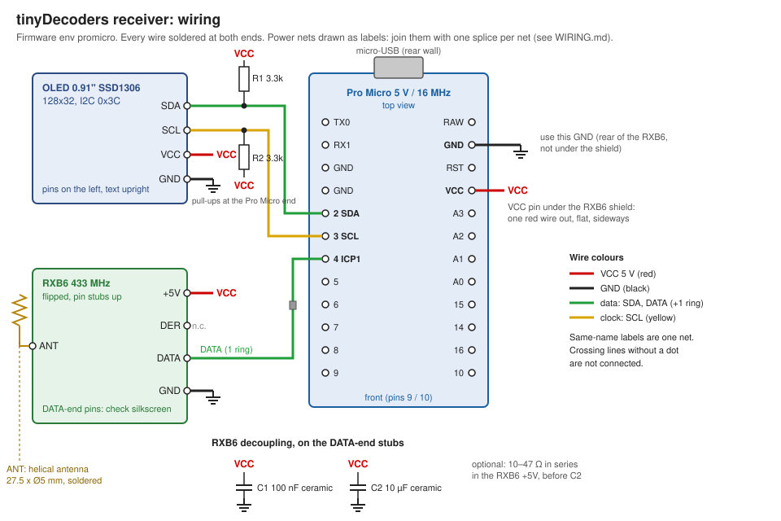

# tinyDecoders receiver: wiring and assembly

This is the **receiver** (433 MHz decoder with OLED, `tinyDecoders/`), not a tinySensor emitter. Emitter boards are documented in `hardware/tinysensor/`.

- Firmware: `tinyDecoders`, env `promicro` (`pio run -d tinyDecoders -e promicro -t upload`)
- Enclosure: `openscad/receiver.scad`, Orca project `openscad/print/receiver.3mf`
- Boards: SparkFun-style Pro Micro 5 V / 16 MHz (ATmega32U4), RXB6 433 MHz superheterodyne receiver, 0.91" SSD1306 OLED 128×32 (I2C, 0x3C, onboard regulator)

## Connections

Every wire is **soldered at both ends** (no Dupont, no JST). Lengths include slack: cut on site.

| From | To (Pro Micro) | Net | Colour | Ends | Length |
|---|---|---|---|---|---|
| RXB6 DATA (DATA end) | pin **4** (PD4 / ICP1) | radio data | green, 1 heat-shrink ring | soldered / soldered | 40 mm |
| RXB6 +5V (DATA end) | VCC splice | VCC | red | soldered / soldered | 60 mm |
| RXB6 GND (DATA end) | GND splice | GND | black | soldered / soldered | 40 mm |
| OLED SDA | pin **2** (SDA) | I2C data | green | soldered / soldered | 70 mm |
| OLED SCL | pin **3** (SCL) | I2C clock | yellow | soldered / soldered | 70 mm |
| OLED VCC | VCC splice | VCC | red | soldered / soldered | 80 mm |
| OLED GND | GND splice | GND | black | soldered / soldered | 70 mm |
| Pro Micro **VCC** (right row) | VCC splice | VCC | red | soldered / soldered | 30 mm |
| Pro Micro **GND** (right row, 2nd from USB) | GND splice | GND | black | soldered / soldered | 30 mm |
| RXB6 ANT (ANT end) | helical antenna 27.5 × Ø5 mm | antenna | — | soldered | — |

Parts on the wires:

| Part | Value | Between | Where |
|---|---|---|---|
| R1 | 3.3 kΩ | SDA – VCC | in line, at the Pro Micro end, in the free zone in front of the RXB6 (validated on the bench: ~4.3 V high, ~160 ns rise) |
| R2 | 3.3 kΩ | SCL – VCC | same |
| C1 | 100 nF ceramic | RXB6 +5V – GND | soldered on the RXB6 DATA-end pin stubs |
| C2 | 10 µF ceramic (X5R/X7R) | RXB6 +5V – GND | same, next to C1 |
| R3 (optional) | 10–47 Ω | in series in the RXB6 +5V, before C2 | RC filter against USB and OLED charge-pump noise |

Not connected: RXB6 DER, the second +5V and both GND pins of the RXB6 ANT end, every other Pro Micro pin.

## Pin positions in the enclosure

Pro Micro top view, micro-USB against the rear wall, seen from the front of the box:

| | Rear (USB) → front |
|---|---|
| Left row | TX0, RX1, GND, GND, **2**, **3**, **4**, 5, 6, 7, 8, 9 |
| Right row | RAW, **GND**, RST, **VCC**, A3, A2, A1, A0, 15, 14, 16, 10 |

The first pin (9 / 10) is 1.5 mm from the front edge. The RXB6 lies across the box, DATA end on the left (near pins 2–4), ANT end on the right. Its DATA end carries +5V, DER, DATA, GND, with +5V and GND on the outside: **read the silkscreen** to know which pin falls to the front once the board is flipped.

## Space under the RXB6

The RXB6 shield sits 1 mm above the Pro Micro components, 2.7 mm above its board. It covers the left-row pins 3, 2, GND, GND and the right-row VCC: their solder joints have about **1.9 mm** of headroom.

- Solder the Pro Micro wires **before** fitting the RXB6, lying flat, leaving **sideways** (along X), never over the components.
- Signal wires: thin wire, 30 AWG wire-wrap (28 AWG at most). Power: 26 AWG is plenty (tens of mA).
- **One wire per pin** under the shield. Bring VCC out with a single red wire to a splice in the free zone in front of the RXB6 (above the front half of the Pro Micro), where the RXB6 +5V, the OLED VCC and R1/R2 join under heat-shrink. Take GND from the right-row GND next to RAW: it lies just behind the RXB6, not under the shield.
- The shield is at GND: put a piece of Kapton tape under it.

## Assembly order

1. Pro Micro: solder SDA, SCL, DATA, VCC and GND wires flat, sideways. Plug its 8 mm header pins into the plate rails (1.2 mm holes; drill them if the pins bind).
2. RXB6: cut the pins to 2–3 mm stubs, solder C1, C2 (and R3) on the DATA-end stubs, then the DATA, +5V, GND wires and the helical antenna on ANT. Kapton under the shield, flip the board onto its two supports (shield on the supports, ergots at its ends), drop of glue.
3. OLED: glue it in the face pocket, pins on the left (text upright), solder SDA, SCL, VCC, GND.
4. Make the VCC and GND splices with R1 and R2, heat-shrink.
5. USB test before closing: the OLED shows "Waiting for data", then decoded sources; RFLink lines come out on the USB serial port at 57600 baud.
6. Close the plate: 4 × M3×6 cylinder-head machine screws (pilot 2.5 mm, drill 2.8 mm if a screw binds).
