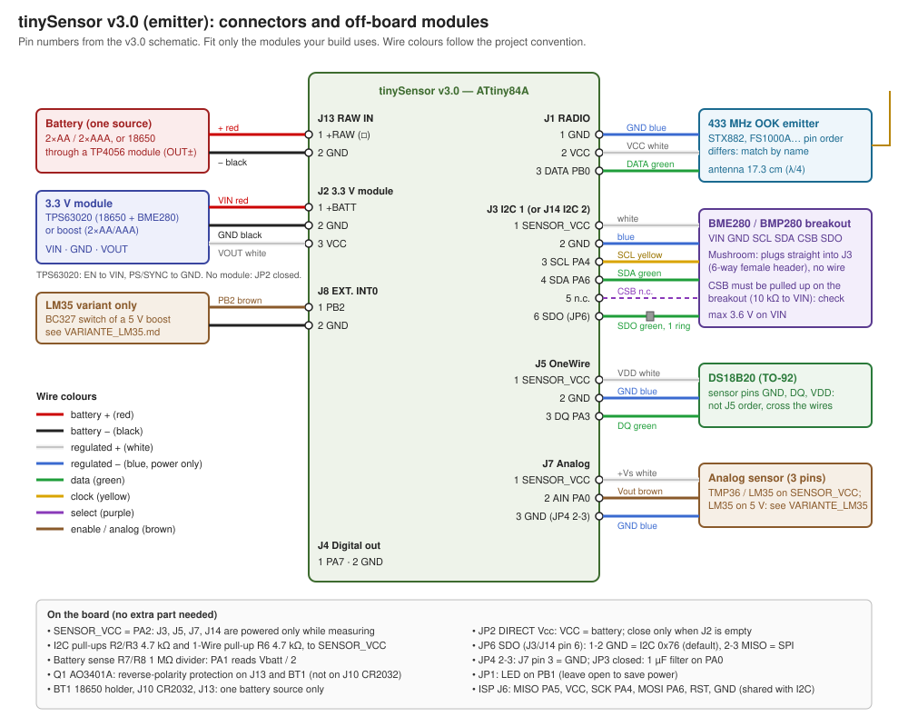

# tinySensor board: connectors and off-board wiring

This is the **tinySensor emitter** board (ATtiny84A, `hardware/tinysensor/`). The 433 MHz receiver with OLED is documented separately in [`hardware/receiver/WIRING.md`](../receiver/WIRING.md).

Pin numbers come from the v3.0 schematic (`tinySensorv1.kicad_sch`, netlist exported with `kicad-cli`). v2.2 boards share the same connectors, with the defects and the fixes listed in [`REWORK_v2.2.md`](REWORK_v2.2.md). Build flags per sensor unit: [`docs/environments.md`](../../docs/environments.md).

## Connectors

| Ref | Name | Pin 1 | Pin 2 | Pin 3 | Pins 4–6 |
|---|---|---|---|---|---|
| J13 | RAW IN (screw terminal) | +RAW (square pad) | GND | | |
| J2 | 3.3 V module (1×03 header) | +BATT | GND | VCC | |
| J1 | RADIO | GND | VCC | DATA (PB0) | |
| J3 | I2C 1 (BME280) | SENSOR_VCC | GND | SCL (PA4) | 4 SDA (PA6), 5 n.c., 6 SDO (JP6) |
| J14 | I2C 2 | same as J3 | | | |
| J5 | OneWire | SENSOR_VCC | GND | DQ (PA3) | |
| J7 | Analog sensor | SENSOR_VCC | AIN (PA0, through R4 75 Ω) | GND with JP4 2-3 | |
| J8 | EXT. INT0 | PB2 | GND | | |
| J4 | Digital out | PA7 | GND | | |
| J6 | ISP | MISO (PA5) | VCC | SCK (PA4, = SCL) | 4 MOSI (PA6, = SDA), 5 RESET, 6 GND |
| J10 | CR2032 socket | +BATT | GND | | |
| BT1 | 18650 holder | + on RAW_IN | − on GND | | |

SENSOR_VCC is PA2: J3, J14, J5 and J7 are powered only while the firmware measures.

## Jumpers

| Jumper | Setting | Effect |
|---|---|---|
| JP2 DIRECT Vcc | closed **only when J2 is empty** | VCC = battery (2×AA/AAA straight on the MCU, build with `BATTERY_IS_VCC`). Closed with a module on J2, it shorts the module input to its output. |
| JP6 SDO | 1-2 (default) | J3/J14 pin 6 = GND: BME280 in I2C at 0x76, the firmware address |
| | 2-3 | pin 6 = MISO, for a sensor in SPI |
| JP4 Analog ref | 2-3 | J7 pin 3 = GND (normal use) |
| JP3 | closed | 1 µF from PA0 to GND: RC filter with R4 on the analog input |
| JP1 LED | closed | LED D1 on PB1. Leave open on battery to save power. |

## On-board parts (no extra part needed)

- I2C pull-ups R2/R3 4.7 kΩ and 1-Wire pull-up R6 4.7 kΩ, all to SENSOR_VCC: no resistor in the harness.
- Battery sense: R7/R8 1 MΩ divider with C7 100 nF, PA1 reads Vbatt / 2 (firmware scaling: BACKLOG F1).
- Q1 AO3401A: reverse-polarity protection on J13 and BT1. **Not on J10** (CR2032).
- R9 10 kΩ RESET pull-up, SW1 reset button, C8 100 nF at the radio.

## Off-board modules

Fit only what your build uses. Wire colours follow the project convention (see `CLAUDE.md`, *Hardware Conventions*): battery pair red/black, regulated pair white/blue (blue is power only), data green, clock yellow, select purple, enable/analog brown. Lengths depend on the enclosure: give them per build; the mushroom harness has exact lengths ([`openscad/faisceau_champignon.pdf`](../../openscad/faisceau_champignon.pdf), generated by `openscad/harness.py`).

### Battery (one source only)

| Source | Where | Wires |
|---|---|---|
| 2×AA or 2×AAA | J13 (1 = +, 2 = GND) | red / black, screw terminal at the board end |
| 18650 | through a TP4056 module, OUT+ / OUT− to J13 (mushroom: W5/W6 of the harness), or in BT1 | red / black |
| CR2032 | J10 | no wire, no reverse protection |

Never fit two sources together: they are in parallel and charge each other.

### 3.3 V module on J2

| Module pin | J2 pin | Colour |
|---|---|---|
| VIN | 1 +BATT | red |
| GND | 2 GND | black |
| VOUT | 3 VCC | white |

- 18650 (up to 4.2 V) with a BME280 (3.6 V max): **TPS63020 buck-boost**. Tie EN to VIN and PS/SYNC to GND (power-save mode, otherwise it idles at a few mA). Check: 3.20–3.40 V on VCC at 3.7 V and 4.2 V in, idle current < 0.1 mA.
- 2×AA/AAA: a 3.3 V boost module, or no module and JP2 closed.
- A boost does not regulate when Vin > 3.3 V: with an 18650 it lets about 3.9 V through. Fine for a DS18B20 or an analog sensor (5.5 V max), not for a BME280.

### Radio on J1

| Module pin | J1 pin | Colour |
|---|---|---|
| GND | 1 | blue |
| VCC | 2 | white |
| DATA | 3 (PB0) | green |

Module pin orders differ (an FS1000A is DATA/VCC/GND): match the pins by name, not by position. Antenna: 17.3 cm straight wire (λ/4 at 433.92 MHz) on the module ANT pad.

### BME280 / BMP280 on J3 (or J14)

| Breakout pin | J3 pin | Colour |
|---|---|---|
| VIN | 1 SENSOR_VCC | white |
| GND | 2 GND | blue |
| SCL | 3 SCL | yellow |
| SDA | 4 SDA | green |
| CSB | 5 n.c. | — |
| SDO | 6 SDO (JP6) | green, 1 ring |

- Mushroom: no wire, the breakout's 6-pin male header plugs into a 6-way 2.54 mm female header soldered under the board in J3.
- CSB is not connected on the board: the breakout must pull it up (≈ 10 kΩ to VIN), otherwise the sensor starts in SPI. Check with a meter; if it is missing, add 10 kΩ from CSB to VIN on the breakout.
- The firmware enables the PA5 pull-up at init: SDO wired to MISO (JP6 2-3) in I2C mode would give address 0x77.

### DS18B20 on J5

| DS18B20 pin (TO-92, flat face, legs down, left to right) | J5 pin | Colour |
|---|---|---|
| GND | 2 GND | blue |
| DQ | 3 DQ (PA3) | green |
| VDD | 1 SENSOR_VCC | white |

The sensor order (GND, DQ, VDD) is not the J5 order (VCC, GND, DQ): cross the wires. Pull-up R6 is on the board.

### Analog sensor on J7

| Sensor pin | J7 pin | Colour |
|---|---|---|
| +Vs | 1 SENSOR_VCC | white |
| Vout | 2 AIN (PA0) | brown |
| GND | 3 (JP4 2-3) | blue |

A TMP36 runs from SENSOR_VCC. An LM35 needs 4 V minimum: on 2×AA/AAA, power it from a 5 V boost switched by PB2 on J8, see [`VARIANTE_LM35.md`](VARIANTE_LM35.md) (`USE_SWITCHED_5V`).

## Checks before closing

1. No battery: J13 pin 1 and pin 2 must not beep together.
2. Battery in, no MCU: VCC (C2) between 3.0 and 3.4 V with a module on J2, or the battery voltage with JP2 closed.
3. Flash, then watch the frames on the receiver (`hardware/receiver/`) or in Home Assistant through RFLink.
