# 3D-printed enclosures — TinySensor v2.2

Parametric OpenSCAD models (tested with OpenSCAD 2021.01). Target material: **PETG**.

| On the wall | On a stand |
|---|---|
| 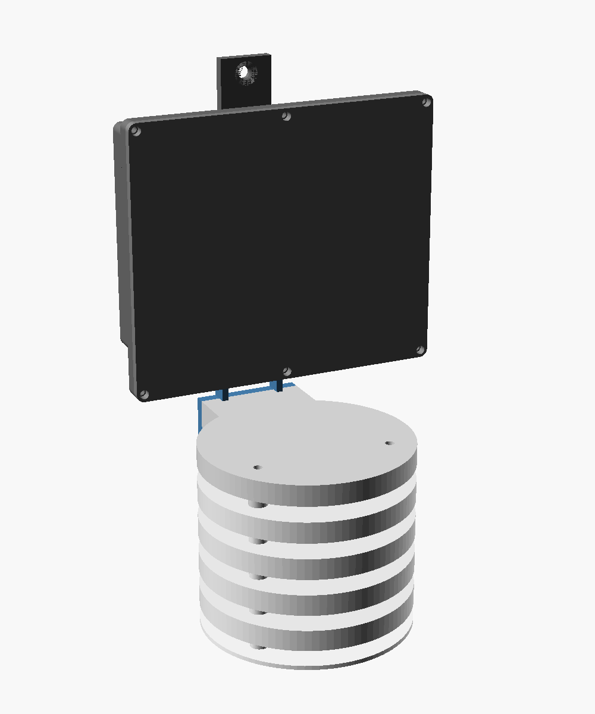 | 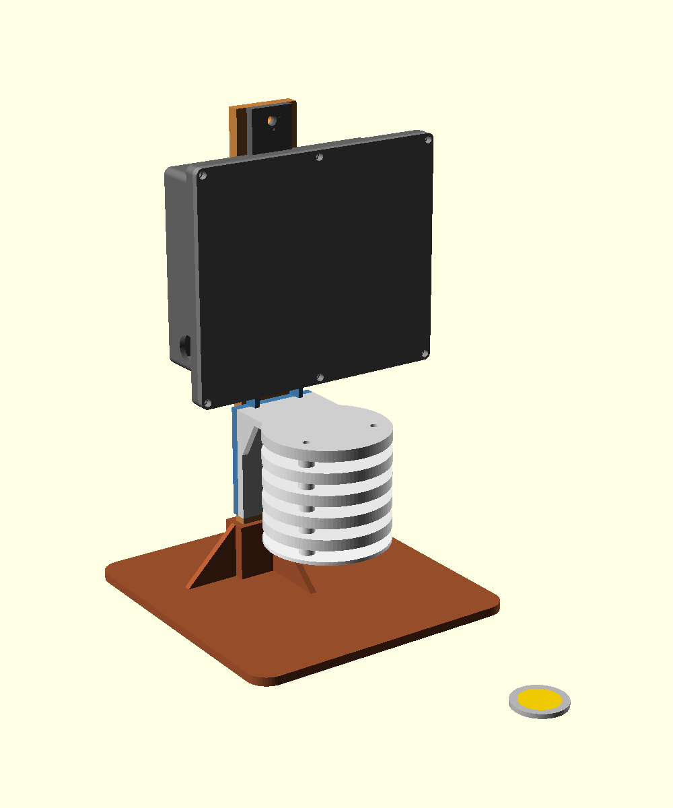 |

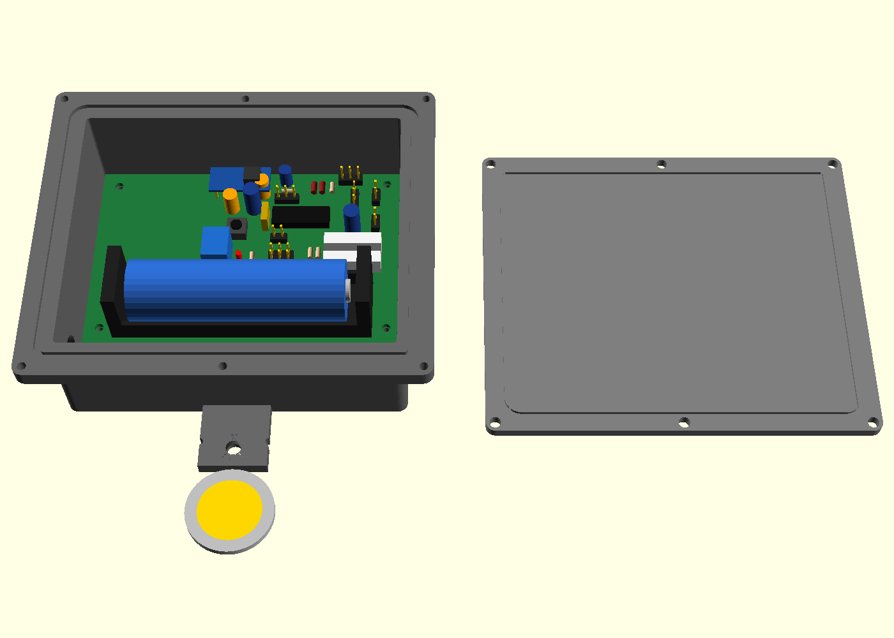

A €2 coin (Ø25.75 mm) appears in the renders for scale.

| File | Content |
|---|---|
| `tinysensor_box.scad` | Main wall box (base + lid) |
| `sensor_shield.scad` | Outdoor radiation shield for a BMx280 breakout + optional clip |
| `stand.scad` | Table stand: mast + foot, to stand the box + shield upright |
| `pcb.scad` | Simplified v2.2 board and 18650 cell (renders only) |
| `euro2.scad` | €2 coin for render scale |
| `mushroom.scad` | Decorative "mushroom" enclosure (alongside the wall box) |
| `receiver.scad` | Desk enclosure of the tinyDecoders receiver (Pro Micro, RXB6, OLED) |
| `harness.py` | Printable mushroom wiring plan generator (`python3 harness.py` → `faisceau_champignon.pdf`, A4) |
| `assembly.scad` | Overview (box + clipped shield, on the wall or on the stand), generates `rendu.png` and `rendu_pied.png` |

> Status: **not printed, not validated** (wall box, shield, stand). Clearances and fits to confirm on the first print.

## Export

Ready-to-slice parts are in `print/`, **one OrcaSlicer project per model**, one plate per use and every object named:

| Project | Plates | Objects |
|---|---|---|
| `box.3mf` | Fond extérieur, Fond intérieur, Couvercle | print only one of the two bases: `ext` (cable gland, outdoor) or `int` (vents, indoor) |
| `shield.3mf` | Abri, Assiettes | Chapeau, Fond, Clip (optional); 4 plates |
| `stand.3mf` | Mât, Pied | table stand, optional |
| `receiver.3mf` | Pupitre | Coque, Fond: tinyDecoders receiver desk enclosure (Pro Micro, RXB6, OLED), M3×6 cylinder-head screws; wiring: [`hardware/receiver/WIRING.md`](../hardware/receiver/WIRING.md) |
| `mushroom.3mf` | Ailettes, Hat, White buttons, Ground, Divers, Foot, Support | Chapeau, Lamelles, Châssis, Plancher, Pied, Sol, Berceau, Bouchon, Pois Ø6 / Ø8 / Ø10 |

Plate and object names are the ones in the Orca projects and in `update_3mf.py` (French, kept as identifiers).

`mushroom_cap.3mf`: mushroom cap as printed (Orca settings of that print). Frozen snapshot, outside `export.sh`.

After changing a `.scad` (about 30 s, close the projects in Orca first):

```bash
./export.sh                  # every project
./export.sh print/box.3mf    # or just one
```

`export.sh` runs `update_3mf.py`, which re-exports each part and replaces its mesh in the project: plates, positions, rotations and Orca settings are kept, the previous project stays as `print/<project>.3mf.bak`. A missing project is recreated, with the printer and filament settings of `mushroom.3mf` (Ender 3). Parts may only be rotated about Z in Orca, otherwise the script refuses to update them; a part deleted in Orca is reported, not put back. Per-object settings set when missing: mushroom cap outer brim 10 mm, 10 % infill; mushroom stem 6 walls. The dot counts are the project's: the "Dots" echo of `mushroom.scad` gives the count to place if the seed or `dot_gap` change.

Exporting a single part outside a project (STL, another format): `openscad -D 'part="lid"' -o out/lid.3mf tinysensor_box.scad` (see each `.scad` header).

Open-box render: `openscad --preview -D 'part="open"' --camera=110,-230,420,110,30,0 --imgsize=1400,1000 -o rendu_ouvert.png tinysensor_box.scad`.

Every part is exported in its print orientation and prints **without support**, the mushroom dome included. `out/` is ignored by git, `print/` is not.

## Main box (`tinysensor_box.scad`)

- Fitted to the v2.2 PCB (`hardware/tinysensor/tinySensorv1.kicad_pcb`): 93.98 × 63.75 mm, held by the 4 corner M2.5 holes on 5 mm standoffs.
- Clearance above the PCB: 25 mm (large capacitors), parameter `comp_h`.
- Free 14 mm bay on the bottom side (18650 holder side) for cables and antenna.
- Overall size: ~117 × 101 × 39 mm (flange and lid included).
- **Closure**: 6 M3 self-tapping screws, outside the seal area.
- **Sealing**: 2.2 × 1.5 mm groove for a Ø2 cord (printed TPU or EPDM), squeezed by a lid rib.
- **Wall mounting**: 2 tabs, Ø4 countersunk screws. The back stays solid.
- Variants (`usage`):
  - `ext`: Ø12.5 hole for a **PG7** cable gland (remote probe). By default in the **left side wall**, level with the bay, under the flange chamfer that keeps the rain off; `gland_side` = `left` / `right` / `bottom` (former position, bottom wall). The cable runs down along the box then up into the shield through its base: allow ~15 cm more and a drip loop.
  - `int`: top and bottom vent slots (convection).
- The bottom tab has two side notches for the shield clip (`shield_notch`).

## Radiation shield (`sensor_shield.scad`)

Stacked-plate shield (Stevenson type): outdoors, a BMx280 shut inside the sealed box would measure the box air, not the ambient air.

- Solid cap + 4 louvred plates + base, Ø56 mm, 10 mm pitch, ~52 mm high.
- Assembly: 3 **M3** threaded rods through the spacers, nuts under the base.
- Base: vertical slide for the **15 × 11 mm, 6-pin** breakout (`BMx280_breakout` footprint), Ø6 cable pass underneath, 6 drain holes.
- Print in **white** (limits solar heating). Place in the shade if possible.

### Mounting (pick one)

1. **Wall**: plate with 2 Ø4 countersunk screws on the probe side. Screw the cap to the wall **before** stacking the plates.
2. **Clip under the box** (`part="clip"`): adapter bolted behind the plate (2 M4×8 countersunk screws + nuts sunk on the wall side). Its two prongs grip the bottom wall tab of the box (45° lips) and a bump snaps into each notch. Fitting: screw the box, slide the shield up until it clicks.
   - Adjustable fit: `bump_r` (grip), `prong_w` (stiffness).

3. **On the stand** (`stand.scad`): see below.

## Table stand (`stand.scad`)

To stand the box + shield upright on a table, with no wall.

- **Mast** 30 × 6 × 212 mm: it stands in for the wall. The box screws onto it by its two wall tabs (M4 countersunk, nuts sunk in the back of the mast); the shield stays clipped under the bottom tab, as on the wall.
- **Foot** 130 × 136 mm with a 25 mm socket and gussets: the mast fits in and is locked by a through M4 screw. It reaches 90 mm forward to balance the shield, which sticks out to ~72 mm from the mast.
- 30 mm of clearance under the shield (`under_clr`) for the loop of the cable that comes up through the base.
- The mast (212 mm) fits a 220 × 220 bed.
- The box and shield dimensions are copied at the top of the file: realign them if the other models change.

### Wiring

- I2C link < 1 m: 4.7 kΩ pull-ups, twisted cable (SDA/GND, SCL/GND).
- The cable leaves the cable gland and runs up into the shield through its base.

Board connectors and module wiring: [`hardware/tinysensor/WIRING.md`](../hardware/tinysensor/WIRING.md).

## Mushroom (`mushroom.scad`)

Decorative fly-agaric variant, which does not replace the wall box. The cap is one piece (dome + gills) sitting on the stem with a slight tilt; all the electronics are in the cap, the stem only carries the cell.

| Overview | Stem | Underside | Section |
|---|---|---|---|
| 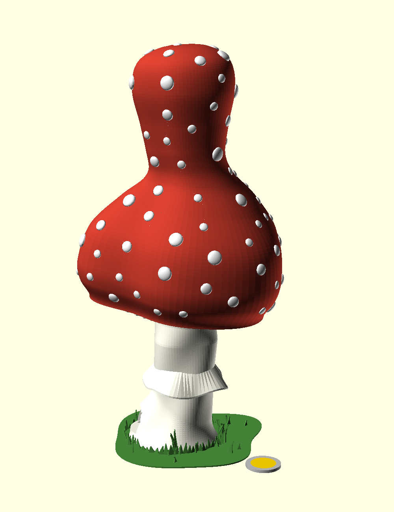 | 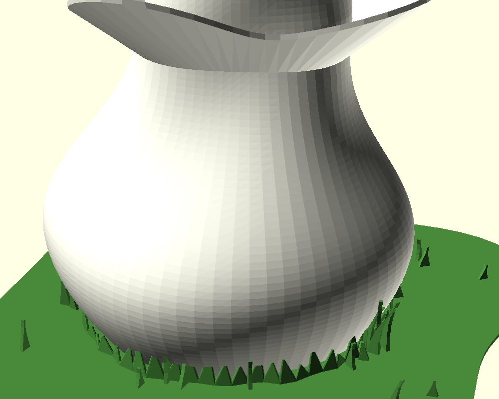 | 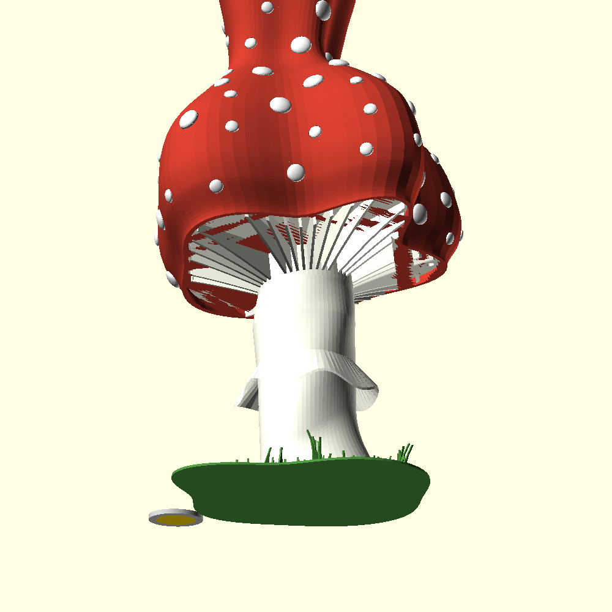 | 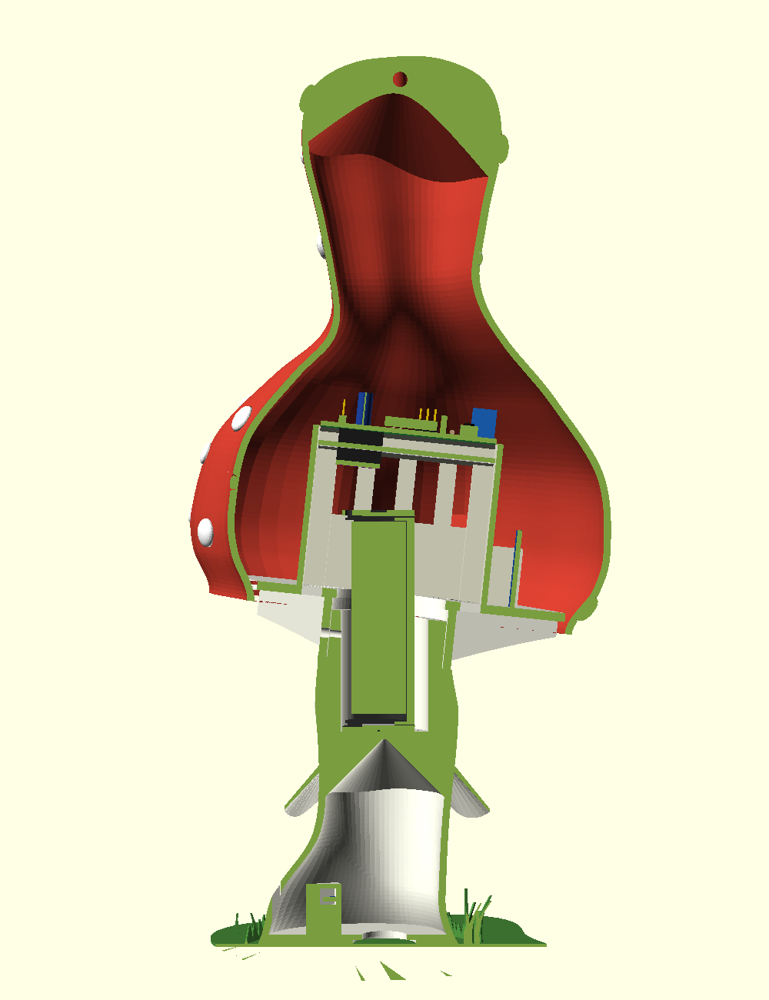 |

Parts:

- **Dome** (`cap`) ~147 × 147 × 190 mm (average max radius 72): **gourd** after a sketch, meridian `cap_shape` (wide bottom, waist Ø~55, top Ø~72), **lobed outline** from a generator (see below). From the narrowing zone (`cap_neck`) up, the top leans 8° towards −X (`cap_lean`, against the cap tilt), to bring the mass back over the stem axis: top ~6 mm from the stem axis on the +X side. The board is turned 180° in the chassis so that the top stays right above **J1 "RADIO"** (433 MHz module), along the board axis (`cap_top` is computed), 126 mm above the board. **Vent** Ø5 (`vent_d`): from the ceiling tip, it runs ~15° down towards the rear flank (+Y), with no dots around it; rain stays out and warm air leaves, opposite J1. The bulk of the bottom goes the other way, towards the flare of the stem. Inner ceiling conical at 45°, no support: the top is solid under the tip. Its edge drops 4 mm below the gill disc (hides its edge) and thickens inwards to **6 mm wide** (`rim_w`, 45° blend): ~2.4 times more bed contact for a 190 mm high part, same silhouette. Fixing: 3 **corbels** on the inner wall, just above the disc (`corbel_*`: 12 mm wide, 10 mm straight face then 45° chamfer to the wall, Ø2.5 × 8 pilot hole); the disc rises into the dome and is pulled against them by 3 M3 × 10 self-tapping screws from below, heads under the disc between the gills. 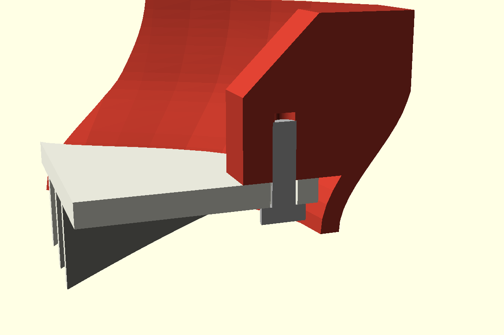
- **Gills** (`gills`): disc closing the underside of the cap, following the narrowest outline of the dome skirt minus 0.4 mm (`disc_fit`) to clear the lobe hollows, 48 radial blades deeper near the stem (`gill_depth`), vent slots between the blades under the sensor chamber (including on the +X side, at 0° and ±7.5°, flush with the +X edge of the BME280), USB socket opening, central sleeve taking the stem tenon. Prints blades up.
- **Chassis** (`chassis`) screwed onto the disc (4 M3 screws from below), printed upright:
  - lower chamber (48 mm, `chamber_h`), ventilated: **BME280 plugged under the board**, no wire or slide (see *Wiring*); the breakout hangs parallel to the board, sensor towards the disc, 42 mm above the disc; chassis windows at the top of the chamber (`win_h`), so that air flows past the sensor. The top of the cradle goes 30 mm through the disc (Ø37 hole, `disc_bore`) and ends 12 mm below the breakout, with the JST-XH pair;
  - **perforated deck** (`deck`) on supports, with a 17.2 × 4.5 mm window for the female header;
  - **cut-down v2.2 board** (60 × 39 mm, along the silkscreen dotted lines x = 147 / y = 87, without the 18650 and CR2032 holders): turned 180° (J1 on −X), 2 M2.5 screws (MH5, top MH1), the bottom edge rests on a ledge. The cell arrives on **J13 "RAW IN"** (`+BATT`/`GND`);
  - slide for the TP4056 **charge module**, upright on the side, **micro-USB facing down** between two gills.
- **Stem** (`stem`) as a **fly-agaric pear** after a sketch: bulbous base (~106 × 96 mm at the belly, Ø70 to Ø85 on the table), neck Ø44 to 50 at the ring, Ø45 under the sleeve, hollow (Ø29.4) to the top: takes the cell cradle, inserted from the top, sitting 72 mm above the ground. Underneath, a closed **ballast chamber** following the stem shape (2.4 mm wall, `ballast_wall`, bulb included), conical ceiling at 45° up to 70 mm (`ballast_h`): ~220 cm³, i.e. ~1 kg of 1 mm steel shot if filled. Filled through a Ø15 hole in the bottom, closed by a **plug** (`plug`, Ø21 × 1.2 mm) glued into a counterbore, flush with the underside. Same spirit as the cap:
  - lobed shaft (`stem_amp`, lobes twisting along the shaft, `stem_twist`); the deformation only adds material, the wall around the cell never gets thinner, and it fades out under the sleeve;
  - asymmetric bulbous base (`bulb_r`, `bulb_z`, `bulb_up`, `bulb_dn`, `foot_dir`): stronger shoulder on one side, underside rounded at 44° at most;
  - **cup** ring under the cap (`ring_z`, `ring_ext`, `ring_rise`), raised wavy edge (`ring_amp`), 45° at most: no support. The waves are phased (`ring_rot`) so that the cup dips under the USB socket: its edge stays 2 mm short of the window under the plug (checked by an `assert`), the cable plugs in from below.
  - At the top, a tenon tilted 6° (`cap_tilt`) fits into the sleeve, 1 radial M3 screw on the +X side, under the USB socket (`collar_screw_a`).
- **Cradle** (`cradle`) 74.8 × Ø27.8 mm: removable trough for a **bare 18650** (65 mm, flat top; `cell_l` for another length), no solder on the cell. Two **tab contacts** (13 × 11 mm plate, drilled 3 × 7 tab) slid into grooves: spring on the "−" side at the bottom, bump on the "+" side at the top (polarity engraved on the ends). Tabs up: each wire soldered on them leaves through the nearby notch (`wire_notch`) and runs along the cell in the top slot up to the sleeve (W1 red 40 mm, W2 black 110 mm, soldered → JST-XH F, see *Wiring*); the wires are soldered to the tabs, not to the cell. The cell goes in through the top slot, compressing the spring (≈ 4 mm, `spring_c`). Ø2.5 pull hole at the top (string, knot inside). Flanks lightened by 3 windows on each side, under the lips that hold the cell (`cr_win`, 15.5 g instead of 21 g solid). Printed flat, flat face on the bed, no support. 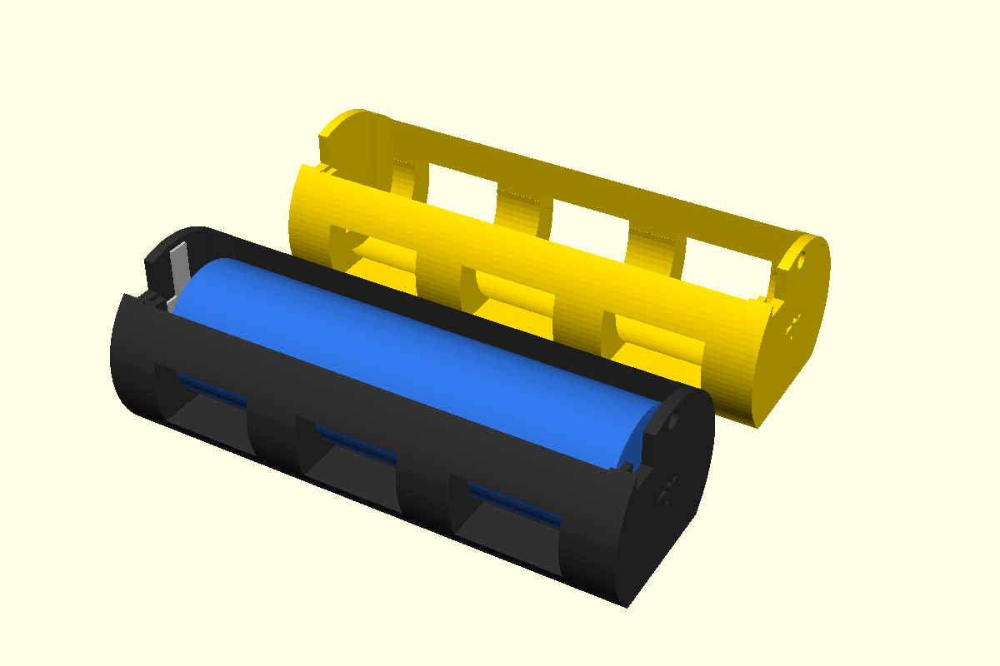
- **Ground** (`ground`): 1 mm disc with a lobed outline (Ø~145, `ground_R`), zigzag grass fringe around the stem, tufts of tall blades and single blades (`grass_*`, `fringe_h`). Separate part to print in green; the stem is glued on it. Widens the footprint.
- **Dots** (`dot`) added afterwards, glued into 0.8 mm recesses, spread by random draw over the real surface (minimum gap `dot_gap`): 99 (Ø6 × 45, Ø8 × 26, Ø10 × 28), the OpenSCAD echo gives the count per size.

Total height ~300 mm.

### Cap outline

The top-view outline is a sum of harmonics (2 to 7) with random phases, weighted around `lobe_n` lobes and normalised to `lobe_amp` (maximum deviation from the mean radius, ±22 % by default). The deformation is full at the edge and fades towards the top (`lobe_top` = share left at the top). The edge stays flat (printed edge on the bed).

- `lobe_seed` changes the shape. Seeds 1 to 8 (top view): 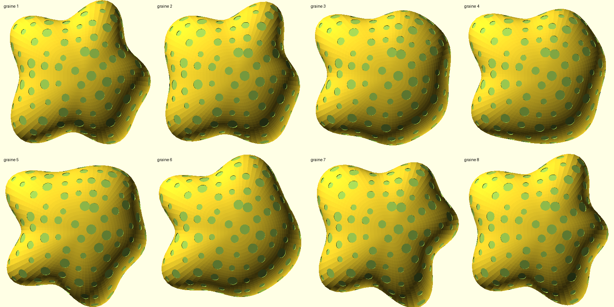
- `lobe_rot`: outline orientation (165° for seed 6); `-1`: OpenSCAD picks the orientation that leaves the most clearance around the electronics (hollows facing the short sides of the chassis, a lobe on the charger). The 3 dome screws place themselves in the lobes.
- The console shows the **clearance index**: ≤ 1 = chassis, board (components ≤ 14 mm) and charge module ≥ 3 mm from the dome everywhere; otherwise a warning (raise `cap_R` / `cap_H` or change seed). The console also shows the wire margin above the cradle; `stem_h` and `ballast_h` do not go below 5 mm of margin (assert).

### Printing

- Every part comes out in its print orientation. The **dome** (190 mm high, fits an Ender 3) prints edge on the bed, **without support**: printed in PETG (~20 h), the corbel bearing faces, 7 mm above the bed, bridge over more than 20 mm with two right angles. Low infill (~10 %): the top is solid in the model (~60 cm³, 76 g at 100 %, ~8 g at 10 %), only to avoid supports behind the neck, and it weighs in the wrong place. The other parts print without support (stem: 113 mm high).
- Stem: **6 walls** (0.4 nozzle): the ballast chamber wall is 2.4 mm (`ballast_wall`), so it is solid without gap infill. 4 walls are enough for the other parts.
- Dome in red (or brown: panther cap), dots in white, ground in green, the rest in white / ivory.
- Ground: blades and fringe 0.9 mm thick, tips at 0.6 mm (0.4 nozzle); the slicer may truncate the finest tips.

### Assembly, cell

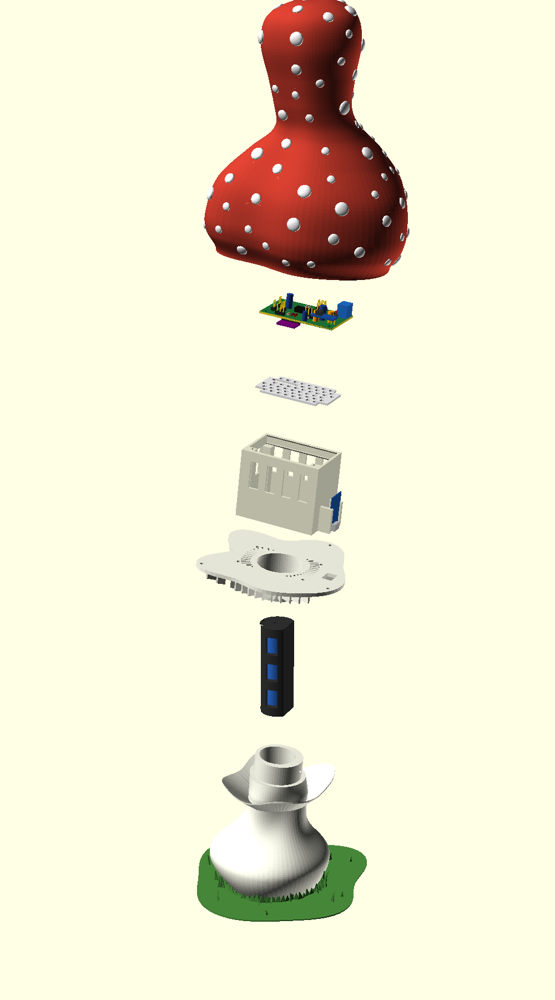

0. Stem upside down: shot through the bottom hole (a few drops of glue to freeze it and stop it rattling), plug glued into its counterbore (epoxy), then stem glued onto the ground.
1. Board: solder a **2.54 mm 1×6 female header** on the **underside** of the board, in the "I2C" footprint; the "I2C" and "I2C_SPI" JSTs are not fitted (see *Wiring*). On the breakout, solder its male header so that the chip faces the disc once plugged in (breakout body towards the inside of the chassis, to check for your breakout model).
2. Charge module: solder W5 / W6 (red / black, 70 mm, OUT+ / OUT− soldered → J13 screw terminal). W3 / W4 are soldered in step 3: the JST-XH housing (~7.4 × 5.8 mm) barely fits through the window of the +Y wall (8 mm wide), so the bare end is passed through.
3. Deck placed in the chassis, board screwed on top (the female header goes through the deck window); chassis upside down, BME280 plugged in from the open underside of the chassis. Charge module in its slide; W5 / W6 (red / black, 70 mm, TP4056 soldered → screw terminal) screwed into J13; W3 / W4 (red / black, 100 mm, TP4056 soldered → JST-XH M): JST-XH M already crimped, chamber side; push the other, bare end from inside the chamber outwards through the +Y wall window (x = 22), then solder it to B+ / B− of the TP4056; the JST side stays in the chamber, above the cradle. Finally chassis onto the gill disc (4 screws from below).
4. Gill disc pushed into the dome up to the 3 corbels, 3 M3 × 10 self-tapping screws from below (heads between the gills). The 433 MHz module antenna goes straight up from J1 into the top of the gourd.
5. Cradle: contacts in the grooves, W1 red 40 mm / W2 black 110 mm soldered at the top of the tabs, out through the end notches (W2 runs along the cell in the top slot) → JST-XH F; cell clipped in; cradle into the stem from the top (spring at the bottom).
6. Cap held ~50 mm above the stem, plug the JST-XH pair, tuck it into the chamber just above the cradle (central hole of the disc), cap fitted on the tenon, radial screw.
7. Changing the cell: remove the radial screw, lift the cap (~50 mm): the JST-XH pair shows, unplug it, pull the cradle out by the string.

### Wiring (mushroom)

Printable A4 plan: [`faisceau_champignon.pdf`](faisceau_champignon.pdf) (generated by `python3 harness.py`). Board connectors: [`hardware/tinysensor/WIRING.md`](../hardware/tinysensor/WIRING.md).

**Sensor, no wire.** The BME280 breakout (6 pins VIN GND SCL SDA CSB SDO, ~15 × 11 mm) plugs its male header straight into a **2.54 mm 1×6 female header** soldered under the board, in the "I2C" footprint (6-pin JST-EH, 2.50 pitch: 0.2 mm cumulated offset over 6 positions, absorbed by the play of the Ø0.95 holes).

- Positions 1-4 = SENSOR_VCC, GND, SCL, SDA = VIN, GND, SCL, SDA.
- Position 5 not connected = CSB: the breakout pull-up keeps the I2C mode.
- Position 6 = GND = SDO: address **0x76**, the one the firmware expects.
- I2C pull-ups R2 / R3 4.7 kΩ on the board (board end); the breakout carries its own too.
- Height: 8.5 mm female + 2.5 mm male plastic; the breakout is above the cradle, 42 mm from the disc; air rises through the disc slots, flows past the sensor, leaves through the high chassis windows and the top vent.

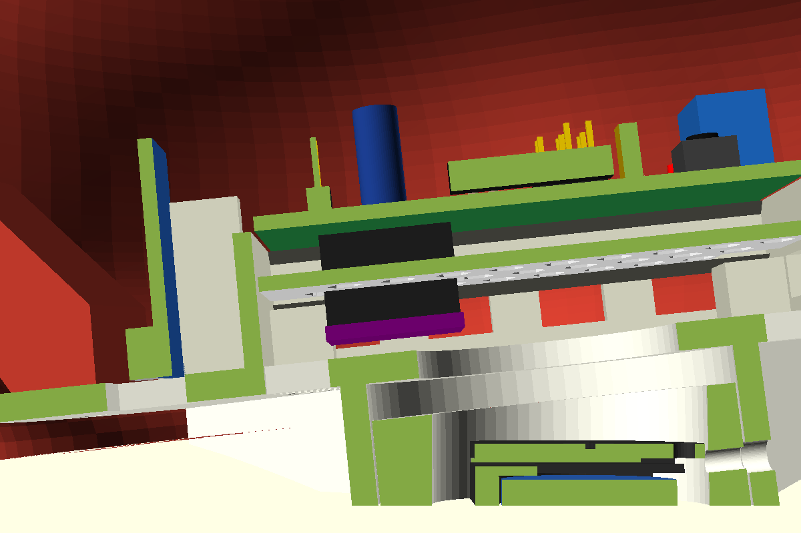

**Cell** (22–24 AWG wire: lower number = thicker wire, W1-W4 carry the 1 A charge current; lengths with 15 to 25 mm of slack, adjust on assembly):

| # | Colour | Signal | From (end) | To (end) | Length | Gauge |
|---|---|---|---|---|---|---|
| W1 | red | B+ | cradle "+" tab (top) — soldered | JST-XH 2p, pin 1 — JST-XH F (cradle side) | 40 mm | 22–24 AWG |
| W2 | black | B− | cradle "−" tab (bottom, runs along the cell in the top slot) — soldered | JST-XH 2p, pin 2 — JST-XH F | 110 mm | 22–24 AWG |
| W3 | red | B+ | JST-XH 2p pin 1 — JST-XH M (cap side) | TP4056 B+ — soldered | 100 mm | 22–24 AWG |
| W4 | black | B− | JST-XH 2p pin 2 — JST-XH M | TP4056 B− — soldered | 100 mm | 22–24 AWG |
| W5 | red | +BATT | TP4056 OUT+ — soldered | J13 "RAW IN" terminal 1 (+BATT) — screw terminal | 70 mm | 22–24 AWG |
| W6 | black | GND | TP4056 OUT− — soldered | J13 terminal 2 (GND) — screw terminal | 70 mm | 22–24 AWG |

Routing:

- JST-XH pair (W1 red 40 mm / W2 black 110 mm, tabs soldered → JST-XH F; W3 / W4 red / black 100 mm, JST-XH M → TP4056 soldered) in the chamber, just above the cradle: lifting the cap by about 50 mm is enough to unplug it through the central hole of the disc.
- W3 / W4 (red / black, 100 mm, JST-XH M → TP4056 soldered) leave the sensor chamber through the +Y wall window (x = 22) and reach the TP4056 (module **with protection**: B+ / B− / OUT+ / OUT− pads, micro-USB facing down).
- W5 / W6 (red / black, 70 mm, soldered → screw terminal) run over the +X wall of the chassis to J13, close by.
- Marking: W3 / W4 and W5 / W6 are two red / black pairs soldered side by side on the TP4056. **1 ring** of heat-shrink at each end of W3 / W4, **2 rings** on W5 / W6: swapping B± / OUT± bypasses the DW01 protection.
- Pre-crimped JST-XH: check red = pin 1 on both sides (M and F) before soldering.
- 433 MHz antenna: straight, from J1 "RADIO" into the top of the gourd (top right above J1).

### Open points

- Cradle (1st print): barely fitted into the stem and the "−" wire did not pass (notch cut with pliers). Fixed for the next print: `cr_fit` clearance 0.8, deeper contact grooves (`bt_sink`), tabs up, wire notch at each end (`wire_notch`).
- Dimensions to measure: contacts (sheet thickness `bt_t`, compressed spring `spring_c`), position of the charge module socket (`usb_cut`), BME breakout (`bme_w/d`, `bme_edge`, female header height `fh_h`).
- No air gap between the dome and the board: the sensor is under the deck, ventilated from below; solar heating to check by measurement.
- Stability: set by the ballast, to check once printed. Estimate (solid PETG shell, support radius ~38 mm): tips over at ~15° without ballast, ~21° with 350 g, ~28° with the chamber full (~1 kg, ~1.7 kg in total, centre of gravity at ~69 mm). Partial filling is enough: freeze it with glue, stem upright.

## Screws and fixings

| Use | Qty | Reference |
|---|---|---|
| PCB → standoffs | 4 | M2.5 × 6 self-tapping |
| Lid | 6 | M3 × 8 self-tapping |
| Box → wall | 2 | Ø4 countersunk + wall plugs |
| Cable gland | 1 | PG7 |
| Seal | ~45 cm | Ø2 TPU/EPDM cord |
| Shield: assembly | 3 | M3 threaded rod ~60 mm + 6 nuts |
| Shield → wall (option 1) | 2 | Ø4 countersunk |
| Clip → shield (option 2) | 2 | M4 × 8 countersunk + nuts |
| Box → mast (stand) | 2 | M4 × 10 countersunk + nuts |
| Mast → foot (stand) | 1 | M4 × 20 + nut |
| Mushroom: board → chassis | 2 | M2.5 × 6 self-tapping |
| Mushroom: chassis → disc | 4 | M3 × 8 self-tapping |
| Mushroom: dome → disc | 3 | M3 × 10 self-tapping (in the corbels) |
| Mushroom: cap → stem | 1 | M3 × 8 self-tapping (radial) |
| Receiver: plate → shell | 4 | M3 × 6 cylinder-head machine screw |

## Connectors and electronics (mushroom)

| Use | Qty | Reference |
|---|---|---|
| Sensor → board (PCB underside, I2C footprint) | 1 | 2.54 mm 1×6 female header |
| Cell ↔ cap | 1 | 2-pin JST-XH male / female pair (pre-crimped or to crimp) |
| Charging | 1 | micro-USB TP4056 module with protection (DW01), 28.7 × 17.15 × 0.9 mm |
| Cradle | 1 set | tab contacts ("−" spring + "+" bump, 13 × 11 mm plate) |
| Harness W1-W6 | ~0.5 m | 22–24 AWG red and black wire |
| Joints | — | heat-shrink |
| Cell | 1 | bare 18650, flat top, 65 mm |
| Sensor | 1 | 6-pin BME280 breakout (address 0x76) |

## Power (to decide)

- 18650 holder on the PCB.
- Available AA/AAA holders: to fit in the bay or in a separate compartment (dimensions to provide).
- Solar: the TP4056 (linear charger, no MPPT) is a poor fit; prefer a CN3065 or a CN3791.
