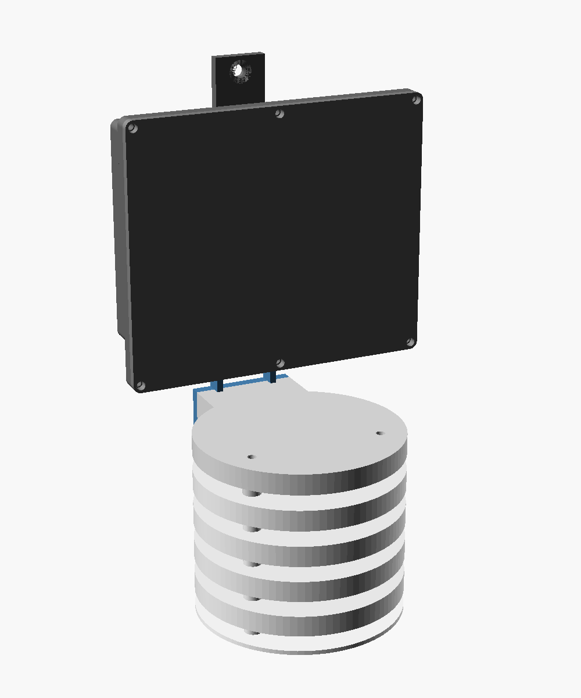
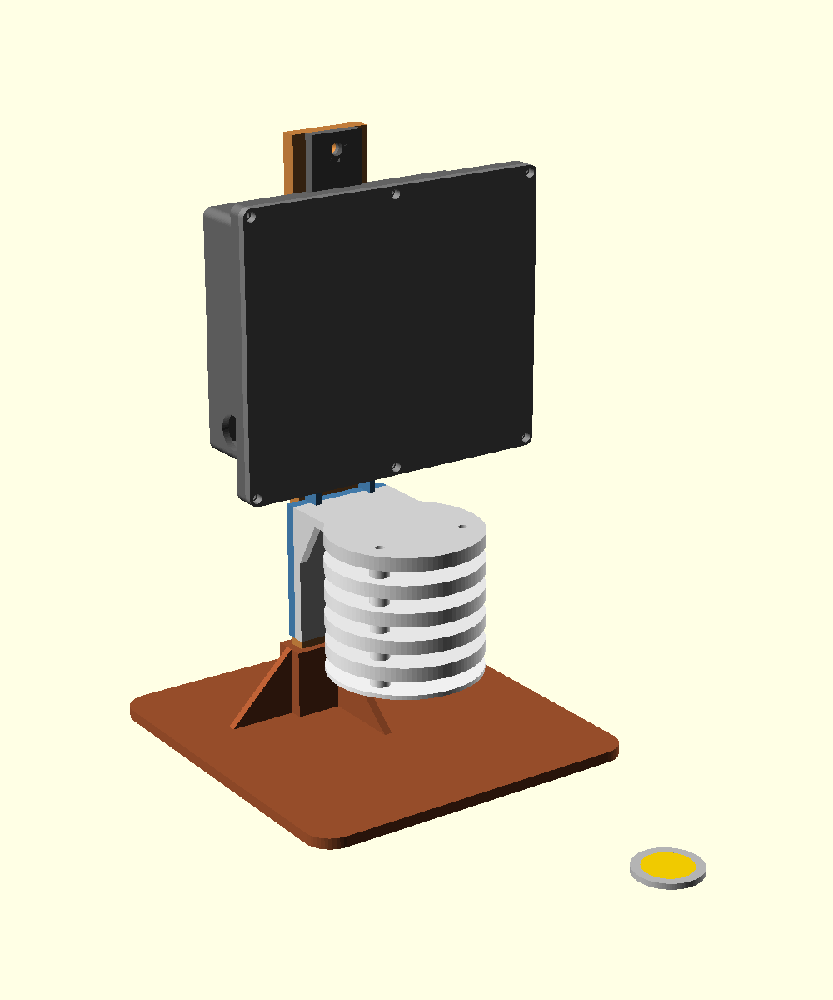
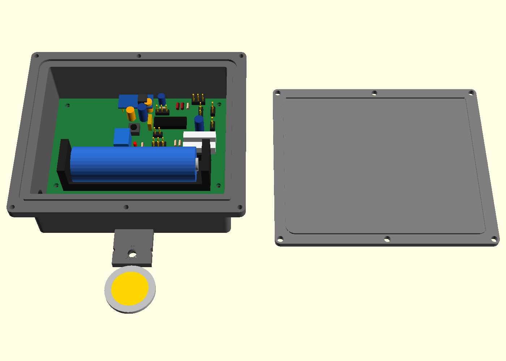
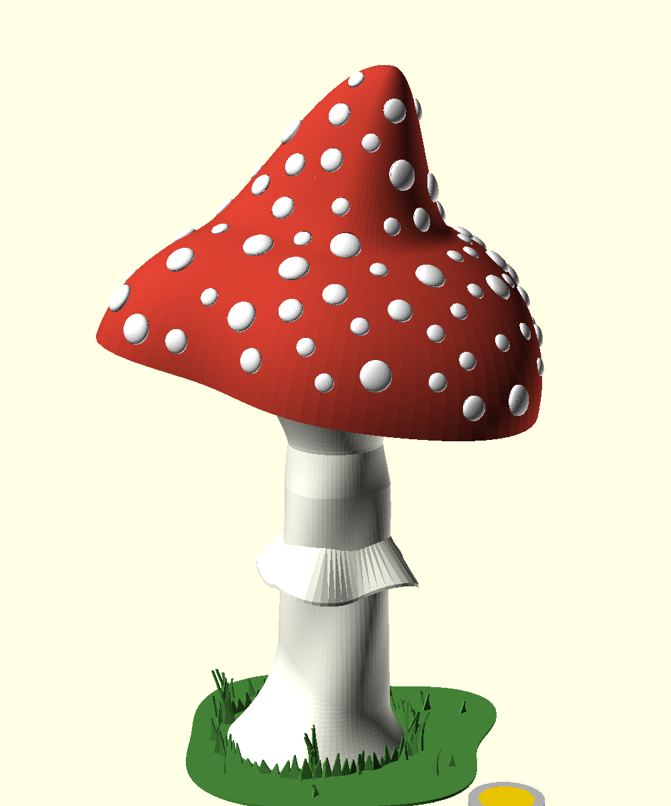
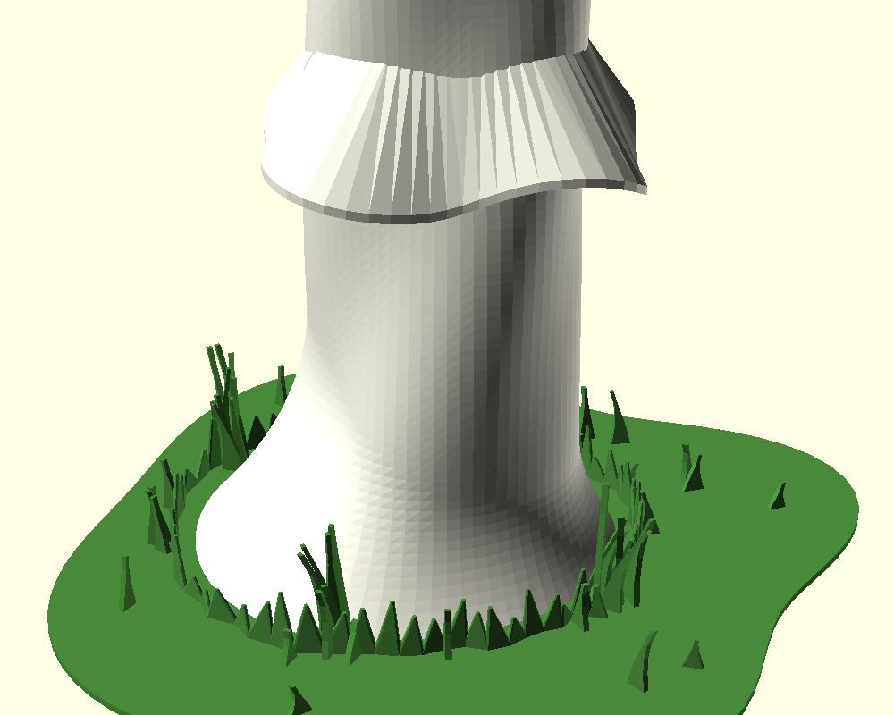
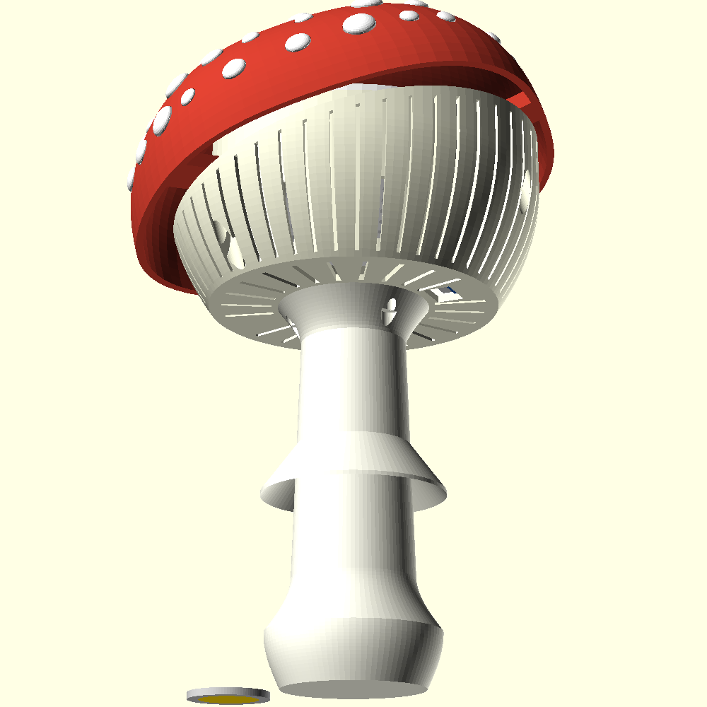
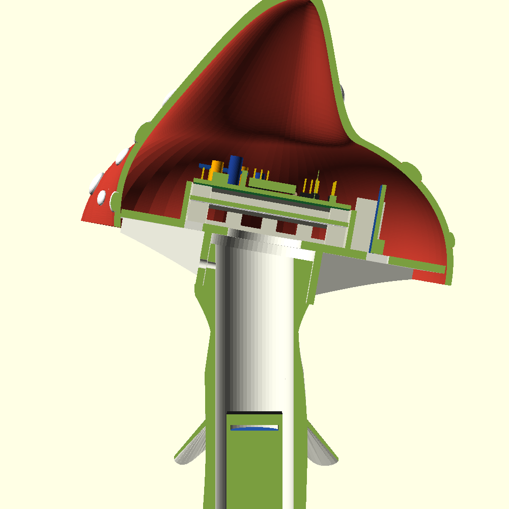
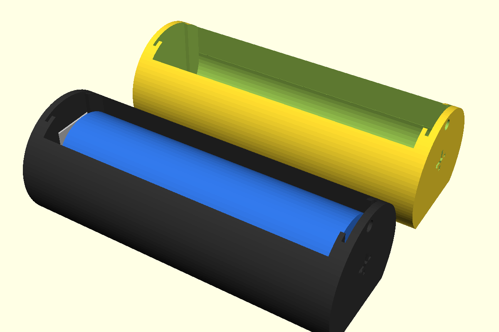
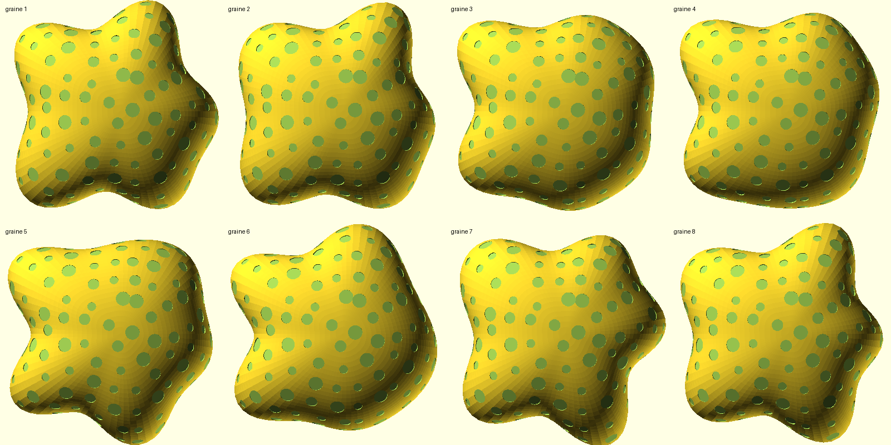

# Boîtiers imprimés 3D — TinySensor v2.2

Modèles OpenSCAD paramétriques (testés avec OpenSCAD 2021.01). Matière visée : **PETG**.

| Au mur | Sur pied |
|---|---|
|  |  |



Pièce de 2 € (Ø25,75 mm) dans les rendus pour l'échelle.

| Fichier | Contenu |
|---|---|
| `tinysensor_box.scad` | Boîtier mural principal (base + couvercle) |
| `sensor_shield.scad` | Abri de sonde extérieur pour breakout BMx280 + clip optionnel |
| `stand.scad` | Pied de table : mât + semelle, pour poser boîtier + abri debout |
| `pcb.scad` | Représentation simplifiée de la carte v2.2 et de l'accu 18650 (rendus uniquement) |
| `euro2.scad` | Pièce de 2 € pour l'échelle des rendus |
| `mushroom.scad` | Boîtier « champignon » décoratif (en plus du boîtier mural) |
| `assembly.scad` | Vue d'ensemble (boîtier + abri clipsé, au mur ou sur pied), sert à générer `rendu.png` et `rendu_pied.png` |

> Statut : **non imprimé, non validé**. Jeux et serrages à confirmer au premier tirage.

## Export

Les pièces prêtes à trancher (3MF, ouverts directement par OrcaSlicer) sont dans `print/`. Le suffixe `_xN` donne le nombre d'exemplaires. Pour les régénérer après une modification (environ 2 min 30) :

```bash
./export.sh        # 3MF dans print/
./export.sh stl    # ou des STL
```

Le boîtier existe en deux variantes, `box_base_ext` (presse-étoupe, extérieur) et `box_base_int` (aérations, intérieur) : n'en imprimer qu'une. Le pied de table (`stand_*`) et le clip d'abri sont optionnels. Les nombres de pois du champignon suivent l'écho « Pois » de `mushroom.scad` : si la graine ou `dot_gap` changent, ajuster les noms dans `export.sh`.

Export d'une seule pièce : `openscad -D 'part="lid"' -o out/lid.3mf tinysensor_box.scad` (voir l'en-tête de chaque `.scad`).

Rendu boîtier ouvert : `openscad --preview -D 'part="open"' --camera=110,-230,420,110,30,0 --imgsize=1400,1000 -o rendu_ouvert.png tinysensor_box.scad`.

Toutes les pièces sont exportées dans leur orientation d'impression et s'impriment **sans support** (sauf l'intérieur du dôme du champignon). `out/` est ignoré par git, pas `print/`.

## Boîtier principal (`tinysensor_box.scad`)

- Calé sur le PCB v2.2 (`hardware/tinysensor/tinySensorv1.kicad_pcb`) : 93,98 × 63,75 mm, fixation par les 4 trous M2.5 des coins sur entretoises de 5 mm.
- Dégagement au-dessus du PCB : 25 mm (gros condensateurs), paramètre `comp_h`.
- Baie libre de 14 mm côté bas (côté support 18650) pour câbles et antenne.
- Encombrement : ~117 × 101 × 39 mm (rebord compris, couvercle inclus).
- **Fermeture** : 6 vis M3 auto-taraudeuses, hors de la zone joint.
- **Étanchéité** : gorge 2,2 × 1,5 mm pour cordon Ø2 (TPU imprimé ou EPDM), écrasé par une nervure du couvercle.
- **Fixation murale** : 2 pattes, vis Ø4 tête fraisée. Le fond reste plein.
- Variantes (`usage`) :
  - `ext` : trou Ø12,5 pour presse-étoupe **PG7** (sonde déportée). Par défaut en **paroi latérale gauche**, au niveau de la baie, sous le chanfrein du rebord qui l'abrite de la pluie ; `gland_side` = `left` / `right` / `bottom` (ancienne position, paroi basse). Le câble redescend le long du boîtier puis remonte dans l'abri par le fond : prévoir ~15 cm de plus et une boucle d'égouttement.
  - `int` : fentes d'aération haut et bas (convection).
- La patte basse porte deux encoches latérales pour le clip de l'abri (`shield_notch`).

## Abri de sonde (`sensor_shield.scad`)

Abri à assiettes (type Stevenson) : en extérieur, un BMx280 enfermé dans le boîtier étanche mesurerait l'air du boîtier, pas l'air ambiant.

- Chapeau plein + 4 assiettes ajourées + fond, Ø56 mm, pas de 10 mm, hauteur ~52 mm.
- Assemblage : 3 tiges filetées **M3** traversant les entretoises, écrous sous le fond.
- Fond : glissière verticale pour le breakout **15 × 11 mm, 6 broches** (empreinte `BMx280_breakout`), passe-câble Ø6 dessous, 6 trous de drainage.
- Imprimer en **blanc** (limite l'échauffement solaire). Poser à l'ombre si possible.

### Fixation (au choix)

1. **Murale** : platine à 2 vis Ø4 fraisées côté sonde. Visser le chapeau au mur **avant** d'empiler les assiettes.
2. **Clip sous le boîtier** (`part="clip"`) : adaptateur boulonné derrière la platine (2 vis M4×8 tête fraisée + écrous noyés côté mur). Ses deux branches enserrent la patte murale basse du boîtier (lèvres à 45°) et un bossage s'enclenche dans chaque encoche. Pose : visser le boîtier, glisser l'abri vers le haut jusqu'au clic.
   - Serrage réglable : `bump_r` (accroche), `prong_w` (souplesse).

3. **Sur pied** (`stand.scad`) : voir ci-dessous.

## Pied de table (`stand.scad`)

Pour poser l'ensemble boîtier + abri debout sur une table, sans mur.

- **Mât** 30 × 6 × 212 mm : il tient lieu de mur. Le boîtier s'y visse par ses deux pattes murales (M4 tête fraisée, écrous noyés dans le dos du mât) ; l'abri reste clipsé sous la patte basse, comme au mur.
- **Semelle** 130 × 136 mm avec douille de 25 mm et goussets : le mât s'y emboîte et se bloque par une vis M4 traversante. Elle déborde de 90 mm vers l'avant pour équilibrer l'abri, qui avance jusqu'à ~72 mm du mât.
- 30 mm de dégagement sous l'abri (`under_clr`) pour la boucle du câble qui remonte par le fond.
- Le mât (212 mm) tient sur un plateau 220 × 220.
- Les cotes du boîtier et de l'abri sont recopiées en tête de fichier : à réaligner si on modifie les autres modèles.

### Câblage

- Liaison I2C < 1 m : pull-ups 4,7 kΩ, câble torsadé (SDA/GND, SCL/GND).
- Le câble sort du presse-étoupe et remonte dans l'abri par le fond.

## Champignon (`mushroom.scad`)

Variante décorative, type amanite, qui ne remplace pas le boîtier mural. Le chapeau est un tout (dôme + lamelles) posé sur le pied avec une légère inclinaison ; toute l'électronique est dans le chapeau, le pied ne porte que l'accu.

| Vue d'ensemble | Pied | Dessous | Coupe |
|---|---|---|---|
|  |  |  |  |

Pièces :

- **Dôme** (`cap`) ~148 × 148 × 102 mm (rayon moyen 72) : super-ellipse (`cap_n`, 52 mm) surmontée d'une **pointe** (`tip_h` = 50 mm) à pentes progressives, flanc doux d'un côté, plus raide de l'autre (`tip_w`), **contour lobé** issu d'un générateur (voir ci-dessous). Son bord descend de 4 mm sous le disque à lamelles et porte 3 pattes au ras du bord : le disque repose dessus, 3 vis M3 par en dessous dans des écrous logés dans le disque.
- **Lamelles** (`gills`) : disque qui ferme le dessous du chapeau, 48 lames radiales plus profondes près du pied (`gill_depth`), fentes de ventilation entre les lames sous la chambre du capteur, ouverture de la prise USB, fourreau central qui reçoit le tenon du pied. S'imprime lames vers le haut.
- **Châssis** (`chassis`) vissé sur le disque (4 vis M3 par en dessous), imprimé debout :
  - chambre du bas (8 mm) : **BME280 couché**, capteur vers les fentes, glissé dans deux rainures ;
  - **plancher percé** (`deck`) sur des appuis ;
  - **carte v2.2 découpée** (60 × 39 mm, le long des pointillés de sérigraphie x = 147 / y = 87, sans les supports 18650 et CR2032) : 2 vis M2.5 (MH5, MH1 du haut), le bord bas repose sur un appui. L'accu arrive sur **J13 « RAW IN »** (`+BATT`/`GND`) ;
  - glissière du **module de charge** TP4056, vertical sur le côté, prise **micro-USB vers le bas** entre deux lamelles.
- **Pied** (`stem`) Ø33 à Ø38, creux (Ø29,4) jusqu'en haut : reçoit le berceau de l'accu, inséré par le haut, posé à 60 mm du sol. Dessous, une **chambre à lest** fermée qui épouse la forme du pied (paroi de 2,4 mm, `ballast_wall`, évasement compris), plafond conique à 45° jusqu'à 58 mm (`ballast_h`) : ~52 cm³, soit ~245 g de grenaille d'acier de 1 mm. Remplissage par un trou de Ø15 dans le fond, fermé par un **bouchon** (`plug`, Ø21 × 1,2 mm) collé dans un lamage, à fleur du dessous. Même esprit que le chapeau :
  - fût lobé (`stem_amp`, lobes qui tournent le long du fût, `stem_twist`) ; la déformation n'ajoute que de la matière, la paroi autour de l'accu ne s'amincit pas, et s'annule sous le fourreau ;
  - base évasée dissymétrique, concave (`foot_flare`, `foot_flare_h`, `foot_dir`) : grand évasement d'un côté, petit de l'autre ;
  - corolle (anneau) au débord et à la retombée ondulés (`ring_amp`), dessous à ~45°.
  - En haut, un tenon incliné de 10° (`cap_tilt`) s'emboîte dans le fourreau, 1 vis M3 radiale.
- **Berceau** (`cradle`) 74,8 × Ø28,6 mm : gouttière amovible pour une **18650 nue** (65 mm, téton plat ; `cell_l` pour une autre longueur), sans soudure sur l'accu. Deux **butées à languette** (plaque 13 × 11 mm, languette 3 × 7 percée) glissées dans des rainures : ressort côté « − » en bas, bossage côté « + » en haut (polarité gravée sur les bouts). Les languettes traversent le fond et sortent dans le méplat, où passent les fils jusqu'au fourreau ; on soude ou on sertit les fils sur les languettes, pas sur l'accu. L'accu entre par la fente du dessus en comprimant le ressort (≈ 4 mm, `spring_c`). Trou de tirage Ø2,5 en haut (ficelle, nœud à l'intérieur). Imprimé à plat, méplat sur le plateau, sans support. 
- **Sol** (`ground`) : disque de 1 mm au contour lobé (Ø~115, `ground_R`), frange d'herbe en zigzag autour du pied, touffes de grands brins et brins isolés (`grass_*`, `fringe_h`). Pièce séparée à imprimer en vert ; le pied se colle dessus. Élargit l'appui au sol.
- **Pois** (`dot`) rapportés, collés dans des logements de 0,8 mm, répartis par tirage sur la surface réelle (pointe comprise, écart mini `dot_gap`) : ~110, l'écho OpenSCAD donne le nombre par taille.

Hauteur totale ~250 mm.

### Contour du chapeau

Le contour vu de dessus est une somme d'harmoniques (2 à 7) à phases aléatoires, pondérées autour de `lobe_n` lobes et normalisées à `lobe_amp` (écart maxi au rayon moyen, ±22 % par défaut). La déformation est pleine au bord et s'atténue vers le sommet (`lobe_top` = part qui reste en haut). Le bord reste plat (impression bord sur le plateau).

- `lobe_seed` change la forme. Planche des graines 1 à 8 (vue de dessus) : 
- `lobe_rot` : orientation du contour (165° pour la graine 6) ; `-1` : OpenSCAD choisit l'orientation qui laisse le plus de jeu autour de l'électronique (creux face aux petits côtés du châssis, lobe sur le chargeur). Les 3 vis du dôme se placent d'elles-mêmes dans les lobes.
- La console affiche l'**indice de jeu** : ≤ 1 = châssis, carte (composants ≤ 14 mm) et module de charge à ≥ 3 mm du dôme partout ; sinon un avertissement (augmenter `cap_R` / `cap_H` ou changer de graine). C'est surtout la hauteur des composants qui fixe `cap_H` (≥ 50).

### Impression

- Toutes les pièces sortent dans leur sens d'impression. Le **dôme** (102 mm de haut) s'imprime bord sur le plateau et demande des **supports à l'intérieur** (plafond et pointe), invisibles une fois monté. Les autres pièces s'impriment sans support (pied : 145 mm de haut).
- Pied : **6 parois** (buse 0,4) : la paroi de la chambre à lest fait 2,4 mm (`ballast_wall`), elle est ainsi pleine sans remplissage d'interstices. 4 parois suffisent pour les autres pièces.
- Dôme en rouge (ou brun : panthère), pois en blanc, sol en vert, le reste en blanc / ivoire.
- Sol : brins et frange de 0,9 mm d'épaisseur, pointes à 0,6 mm (buse 0,4) ; le slicer peut tronquer les pointes les plus fines.

### Montage, accu

0. Pied à l'envers : grenaille par le trou du fond (quelques gouttes de colle pour la figer et éviter qu'elle sonne), bouchon collé dans son lamage (époxy), puis pied collé sur le sol.
1. Châssis sur le disque à lamelles (4 vis par en dessous), BME glissé dans ses rainures, plancher, carte, module de charge dans sa glissière.
2. Écrous M3 dans les logements du disque, dôme posé, 3 vis par en dessous.
3. Butées dans le berceau, fils sur les languettes, accu clipsé ; berceau dans le pied par le haut (ressort en bas), fils dans le fourreau jusqu'à J13, chapeau emboîté sur le tenon, vis radiale.
4. Changer l'accu : retirer la vis radiale, soulever le chapeau, sortir le berceau par la ficelle. Prévoir un connecteur sur les fils de l'accu.

### Points ouverts

- Cotes à mesurer : butées (épaisseur de tôle `bt_t`, ressort comprimé `spring_c`), module de charge (`chg_w/l/t`, position de la prise `usb_cut`), breakout BME (`bme_w/d`).
- Antenne 433 MHz (17 cm) : en cercle à l'intérieur du dôme, ou le long de l'accu dans le pied.
- Pas de lame d'air entre le dôme et la carte : le capteur est sous le plancher, ventilé par en dessous ; échauffement au soleil à vérifier par mesure.
- Stabilité : le sol (Ø~115, 1 mm) élargit l'appui ; le lest (~245 g dans les 60 mm du bas) abaisse le centre de gravité. Stabilité réelle à vérifier une fois imprimé.

## Visserie

| Usage | Qté | Référence |
|---|---|---|
| PCB → entretoises | 4 | M2.5 × 6 auto-taraudeuse |
| Couvercle | 6 | M3 × 8 auto-taraudeuse |
| Boîtier → mur | 2 | Ø4 tête fraisée + chevilles |
| Presse-étoupe | 1 | PG7 |
| Joint | ~45 cm | cordon Ø2 TPU/EPDM |
| Abri : assemblage | 3 | tige filetée M3 ~60 mm + 6 écrous |
| Abri → mur (option 1) | 2 | Ø4 tête fraisée |
| Clip → abri (option 2) | 2 | M4 × 8 tête fraisée + écrous |
| Boîtier → mât (pied) | 2 | M4 × 10 tête fraisée + écrous |
| Mât → semelle (pied) | 1 | M4 × 20 + écrou |
| Champignon : carte → châssis | 2 | M2.5 × 6 auto-taraudeuse |
| Champignon : châssis → disque | 4 | M3 × 8 auto-taraudeuse |
| Champignon : dôme → disque | 3 | M3 × 10 + écrou |
| Champignon : chapeau → pied | 1 | M3 × 8 auto-taraudeuse (radiale) |

## Alimentation (à trancher)

- Support 18650 sur le PCB.
- Boîtiers AA/AAA disponibles : à intégrer dans la baie ou dans un compartiment séparé (dimensions à fournir).
- Solaire : le TP4056 (chargeur linéaire, sans MPPT) est peu adapté ; préférer un CN3065 ou un CN3791.
